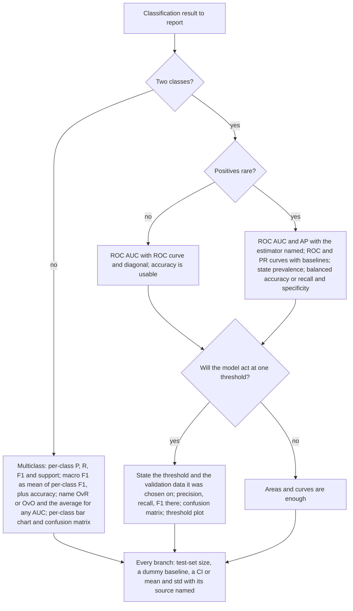

## TL;DR
A reader should be able to rebuild every number in the results table, so name each metric with its averaging, give the test-set size and the prevalence or class supports, and say how the threshold was chosen *(inference)*. TRIPOD+AI asks for the measures, the event counts in each analysis and the threshold rationale[^tripod]. Choose the metrics by problem type *(inference: from the earlier Findings in this Topic)*:
- balanced binary: ROC AUC plus the metrics at the operating point *(inference)*;
- imbalanced binary: add AP, the prevalence and balanced accuracy *(inference)*;
- multiclass: macro F1 next to accuracy, plus a per-class table *(inference)*.

Give every headline number an uncertainty and name its source of variation[^neurips]. For one trained model, use a percentile bootstrap CI over test samples[^hest]. For training randomness, report mean ± std over seeds or folds, saying whether it is the std or the standard error[^neurips]. Fold scores are correlated, because the training sets overlap, so a naive t-test on them is too liberal[^diet][^nb]. Put a `DummyClassifier` baseline and the PR chance level (precision = prevalence) next to the model[^skguide][^saito]. Pick the model and the threshold on validation data only, and report the split[^skcv][^skthr].

## Explanation
A metric value means little until the reader knows which metric it is, on what data, at what threshold, how much it would move on another sample, and what a trivial classifier scores *(inference)*. The five earlier Findings each fixed one of these choices, and this page turns them into a reporting recipe without re-deriving them *(inference)*:
- [the confusion matrix and basic metrics](confusion-matrix-basic-metrics.md) *(inference)*;
- [ROC AUC and PR-AUC](roc-auc-vs-pr-auc.md) *(inference)*;
- [class imbalance](class-imbalance-metric-choice.md) *(inference)*;
- [multiclass averaging](multiclass-averaging.md) *(inference)*;
- [the decision threshold](decision-threshold.md) *(inference)*.

It adds what those pages left out: uncertainty, baselines, data hygiene and wording *(inference)*. The norms below are written for papers *(inference)*. The section [What a short report can drop](#what-a-short-report-can-drop) says which parts a technical report can trim *(inference)*. Notation and layout stay as before: rows of a confusion matrix are the actual class, $P$ and $N$ count actual positives and negatives, $\pi = P/(P+N)$ is the prevalence, and $s_k$ is the support of class $k$ *(inference)*.

### Two guidelines worth knowing
- **NeurIPS paper checklist.** Item 7 asks for error bars, confidence intervals or significance tests, at least for the experiments that support the main claims[^neurips]. The error bars must come with three statements[^neurips]:
  - the factors of variability they capture (train/test split, initialization, or a whole run)[^neurips];
  - how they were computed (closed form, library call, bootstrap)[^neurips];
  - whether they show the standard deviation or the standard error of the mean[^neurips].

  Item 6 asks for the data splits and for how the hyperparameters were chosen[^neurips].
- **TRIPOD+AI (2024).** This is the reporting guideline for clinical prediction models built with regression or machine learning[^tripod]. Its items cover the measures and plots used and why, the data partition, the number of participants and outcome events in each analysis, the threshold, and confidence intervals for performance[^tripod]. Outside medicine it is still a useful checklist of what a reader needs *(inference)*.

### The main results table
**Columns every table needs.**
- **The test set.** Give its size $n$, and the prevalence $\pi$ for binary or the supports $s_k$ for multiclass *(inference)*. TRIPOD+AI asks for the number of participants and outcome events in each analysis[^tripod]. The prevalence is the PR baseline, so an AP cannot be judged without it[^saito][^brabec].
- **Each metric's exact name.** Write "F1 of the positive class", "macro F1 (mean of per-class F1)" or "ROC AUC, one-vs-rest, macro", never a bare "F1" or "AUC" *(inference)*. For binary data, scikit-learn's default `average='binary'` scores only `pos_label`, while `'macro'` averages the F1 of both classes[^skf1]. On the binary toy the two differ by 0.10 ([multiclass-averaging, binary example](multiclass-averaging.md#example-macro-f1-on-the-binary-toy)) *(inference)*. For macro F1, say which of the two formulas you mean, as Opitz and Burst ask[^ob]. For multiclass ROC AUC, name OvR or OvO and the average, because OvR macro is sensitive to class imbalance and OvO macro is not[^skrocauc].
- **The PR-area estimator.** Say whether "PR-AUC" means step-wise AP or a trapezoidal area, since they give different numbers ([ROC/PR, when to use which](roc-auc-vs-pr-auc.md#when-to-use-which)) *(inference)*.
- **Where the threshold came from.** TRIPOD+AI asks for the rationale for any classification and how the thresholds were identified[^tripod]. Write the value, the rule (for example max F1, a recall target, Youden's J or a cost ratio), and the data it was chosen on ([decision-threshold](decision-threshold.md#threshold-free-and-threshold-metrics-how-they-connect)) *(inference)*.

**Which metrics, by problem type.**

| problem type | threshold-free headline | at the operating point | context to state |
|---|---|---|---|
| binary, roughly balanced | ROC AUC | accuracy, precision, recall, F1 of the positive class | $n$, $P$, $N$, threshold and how it was chosen |
| binary, imbalanced | ROC AUC and AP (name the estimator) | precision, recall, F1 of the positive class; balanced accuracy or recall and specificity | $n$, $P$, $\pi$, the all-negative accuracy $1-\pi$, threshold and how it was chosen |
| multiclass, single-label | macro ROC AUC with OvR or OvO named, if scores exist | macro F1 (mean of per-class F1), accuracy; weighted F1 optional; per-class P, R, F1 | $n$ and every $s_k$ |

*Figure: which metrics to put in the main table, by problem type (inference: the rows collect the reporting rules of the earlier Findings). On balanced data accuracy equals balanced accuracy[^skguide]. Under imbalance, report the prevalence and do not let accuracy stand alone, as the [class-imbalance Finding](class-imbalance-metric-choice.md#what-to-report-at-low-prevalence) argues[^brabec][^skguide]. McDermott et al. do not argue against reporting both areas and both curves[^mcd]. In single-label multiclass, micro F1 equals accuracy, and macro gives each class equal weight[^skguide].*

- **Picking the headline area.** Use ROC AUC when the threshold and costs are not known, and AP when the costly errors are false positives among the top-scored instances[^mcd]. The [class-imbalance Finding](class-imbalance-metric-choice.md#the-debate-is-pr-more-informative-than-roc-under-imbalance) covers the debate *(inference)*.
- **The per-class table is part of the main result in multiclass.** No single average shows which class fails ([multiclass, which average](multiclass-averaging.md#which-average-to-use-and-what-to-write-in-a-paper)) *(inference)*. scikit-learn's `average=None` returns the per-class scores[^skguide].
- **Report the metric at the operating point and the area.** Tuning the threshold changes the class predictions but not the ROC or PR curves[^skthr]. So the area alone says nothing about the deployed classifier, and F1 alone says nothing about the ranking *(inference)*.

### Figures
TRIPOD+AI asks authors to specify every plot used to evaluate performance and why, and to consider plots when presenting results[^tripod]. scikit-learn's Display objects draw a confusion matrix, ROC, PR, DET and calibration curves from a fitted estimator or from predictions[^skviz]. Which figure earns its place depends on the claim *(inference)*:

- **Confusion matrix.** Include it when the error types matter, and always for a multiclass problem with a weak class *(inference)*.
  - *Counts or row-normalised.* scikit-learn's `normalize='true'` normalizes the matrix over the true conditions, its rows[^skcm]. With rows for the actual class, the diagonal then holds each class's recall *(inference)*. Use counts when the test set is small, so the reader sees that 2 of 10 is not 20 of 100 *(inference)*. Use row-normalised values when the classes differ a lot in size, and then also state the supports *(inference)*.
  - *Say the layout.* State which axis is the actual class, because sources differ ([first Finding](confusion-matrix-basic-metrics.md#the-confusion-matrix)) *(inference)*.
  - *Example.* The multiclass example below shows the same matrix as counts and as row-normalised rates *(inference)*.
- **ROC and PR curves, with their baselines.**
  - *Baselines.* Draw the ROC diagonal and the PR line at precision $=\pi$[^saito]. scikit-learn's `plot_chance_level` draws both, and for PR it puts the chance level at the prevalence of the positive label[^skprd][^skrocd].
  - *Draw PR step-wise.* scikit-learn draws the PR curve step-wise by default, to match AP, which it computes without interpolation[^skprd].
  - *Examples.* See [the toy ROC curve](assets/roc-auc-vs-pr-auc/toy-roc-curve.svg) and [the toy PR curve](assets/roc-auc-vs-pr-auc/toy-pr-curve.svg) *(inference)*.
  - *Both at low prevalence.* Under imbalance, plot both curves, as the [class-imbalance Finding](class-imbalance-metric-choice.md#what-to-report-at-low-prevalence) recommends[^mcd][^saito]. If the deployment prevalence differs from the test set's, a precision-against-prevalence plot like [this one](assets/class-imbalance-metric-choice/precision-vs-prevalence.svg) shows the effect *(inference)*.
- **Per-class bar chart (multiclass).** One bar per class with the averages drawn across shows at a glance which class pulls macro F1 down *(inference)*. See [per-class F1 with the three averages](assets/multiclass-averaging/per-class-f1-averages.svg) *(inference)*.
- **Threshold plot.** A plot of several metrics against the threshold helps when more than one metric matters[^skthr]. Include one when you claim a tuned operating point, so readers can see how flat or sharp the optimum is *(inference)*. See [the threshold sweep](assets/decision-threshold/threshold-sweep.svg) *(inference)*.

### Uncertainty
The terms used below (standard error, confidence interval, Type I error, bootstrap) are summarised in the [statistical inference](../../fundamentals/statistical-inference/README.md) Prerequisite *(inference)*.

**Why a point estimate is not enough.** Bouthillier et al. model the test-set accuracy of a pipeline that errs with probability $\tau$ on $n$ i.i.d. samples as binomial, and this simple model matches the spread they see when bootstrapping the data[^bout]. The standard deviation of the measured accuracy is therefore about *(inference: the binomial standard deviation divided by $n$)*

$$\operatorname{sd}(\widehat{\text{acc}}) \approx \sqrt{\frac{\tau(1-\tau)}{n}}.$$

They also note that improvements smaller than this test-set variance will not generalize[^bout]. On the binary toy, with accuracy 0.75 and $n = 20$, this is $\sqrt{0.75 \cdot 0.25/20} \approx 0.097$ *(inference)*.

**Two different questions, two different intervals.**
- *How precise is this one model's test score?* The variation comes from which test samples were drawn, and a bootstrap over the test set estimates it *(inference)*.
- *How much does the training procedure vary?* The variation comes from seeds, data order, splits and hyperparameter search, and repeating the training estimates it *(inference)*.

The NeurIPS checklist asks you to state which factors of variability your error bars capture[^neurips]. In Bouthillier et al.'s case studies, bootstrapping the data is the largest source of variance, and weight initialization is generally under half of it[^bout]. So a std over seeds on one fixed test set leaves out the largest source of variance there *(inference)*.

#### The percentile bootstrap CI for a test-set metric
1. **Resample.** Draw $n$ test samples with replacement from the $n$ (label, score) pairs, compute the metric $\hat\theta^*_b$, and repeat for $b = 1, \dots, B$[^hest]. The model and the threshold stay fixed, and only the test set is resampled *(inference)*.
2. **Take percentiles.** The percentile interval is the middle $1-\alpha$ of the bootstrap values[^hest]:
   $$\text{CI}_{1-\alpha} = \big[\, q_{\alpha/2},\ q_{1-\alpha/2} \,\big], \qquad q_\gamma = \text{the } \gamma \text{ quantile of } \{\hat\theta^*_1, \dots, \hat\theta^*_B\}.$$
   The bootstrap standard error is the standard deviation of the same values[^hest].
3. **Stratify for class-ratio metrics.** A two-sample bootstrap draws the resamples independently from each group[^hest]. Applied to the two classes, it keeps $P$ and $N$, and so $\pi$, fixed in every resample *(inference)*. That keeps AP's baseline fixed and avoids resamples with no positives, where ROC AUC is undefined *(inference)*.
4. **Choose $B$.** Hesterberg suggests $B = 1000$ for rough intervals and $10^4$ or more when accuracy matters[^hest].

Two cautions:
- **Small samples.** The common percentile interval "badly under-covers in small samples"[^hest]. In a stratified bootstrap, its narrowness bias depends on the size of each stratum, not the combined size[^hest]. For a binary metric the small stratum is usually the positives *(inference)*. "Bootstrapping does not overcome the weakness of small samples as a basis for inference"[^hest].
- **Bounded metrics.** For a metric bounded by 1, the interval can run into the bound, as in the toy below *(inference)*. The NeurIPS checklist warns against symmetric error bars that leave the valid range for asymmetric distributions[^neurips], and the percentile interval is not forced to be symmetric *(inference)*.

The standard error of an ROC AUC from closed-form formulas (Hanley-McNeil, DeLong) is a separate open Question in the [Topic README](README.md) *(inference)*.

#### Mean ± std over seeds or folds
For $k$ runs (seeds, or folds of cross-validation) with scores $m_1, \dots, m_k$ *(inference: notation)*:

$$\bar m = \frac{1}{k}\sum_{i=1}^{k} m_i, \qquad s = \sqrt{\frac{1}{k-1}\sum_{i=1}^{k} (m_i - \bar m)^2}, \qquad \text{SE} = \frac{s}{\sqrt{k}}.$$

- **Notation.** $s^2$ with $k-1$ in the denominator is the usual sample variance[^hest]. Say which one you divide by, since some tools default to $k$ *(inference)*.
- **std or SE.** The std $s$ describes how much one run varies, and the SE describes how precisely $\bar m$ is known *(inference)*. The checklist asks that it be clear which one is shown, and allows 1-sigma error bars as long as you say so[^neurips].
- **What scikit-learn prints.** The cross-validation guide summarises `cross_val_score` results as "the mean score and the standard deviation"[^skcv].
- **Stratified folds understate the spread.** scikit-learn notes that stratification "can artificially shrink the spread of the metric measured across cross-validation iterations", so with rare classes the inter-fold spread no longer reflects the uncertainty[^skcv].
- **Randomize more, not less.** Bouthillier et al. recommend randomizing as many sources of variation as possible (initialization, data sampling, augmentation, hyperparameter search)[^bout]. It both estimates the variance and reduces the error of the average[^bout].

#### Why fold scores are not independent
- **The training sets overlap.** In $k$-fold cross-validation the test sets are disjoint, but in 10-fold CV each pair of training sets shares 80% of the examples[^diet]. In general two training sets share $k-2$ of the $k$ folds, which is $(k-2)/k$ of all the examples and $(k-2)/(k-1)$ of each training set *(inference)*. Dietterich measured a correlation of 0.0378 between the error differences on two folds, significantly different from 0 with $p < 10^{-10}$[^diet].
- **Repeated random splits overlap too.** With repeated random train/test splits, both the test sets and the training sets of different trials overlap, so the trial differences are not independent[^diet].
- **What correlation does to the variance.** Nadeau and Bengio's Lemma 1 covers $k$ scores with common variance $\sigma^2$ and pairwise correlation $\rho$[^nb]. For such scores *(inference: their Lemma 1 in this page's symbols)*
  $$\mathbb{E}[s^2] = \sigma^2 (1 - \rho), \qquad \operatorname{Var}(\bar m) = \sigma^2\left(\rho + \frac{1 - \rho}{k}\right).$$
  With $\rho > 0$, $s^2/k$ underestimates $\operatorname{Var}(\bar m)$ twice over: $s^2$ is too small, and the $\rho\,\sigma^2$ term never shrinks with $k$ *(inference)*. So $s/\sqrt{k}$ is too small an SE for fold or resample scores, and more folds do not fix it *(inference)*.

#### How to say which one you report
Write one sentence that names the method, the source of variation and the quantity, for example *(inference: wording that follows the NeurIPS item 7 guidelines[^neurips])*:
- "95% CIs from a stratified percentile bootstrap over the test set ($B = 10\,000$), with the model and threshold fixed."
- "Mean ± standard deviation over 5 training seeds on one fixed test split; the std captures initialization and data order only."
- "Mean ± standard deviation over the 10 folds of stratified cross-validation; the folds share training data, so this is not a standard error."

#### Comparing two classifiers, briefly
- **One training run per model: McNemar's test.** Train both models once and run them on the same test set, then count the test examples each model got wrong[^diet]. This error-disagreement table is not a confusion matrix: its cells count agreement between the two models' errors, not actual against predicted classes *(inference)*.

  | | B wrong | B right |
  |---|---|---|
  | **A wrong** | $n_{00}$ | $n_{01}$ |
  | **A right** | $n_{10}$ | $n_{11}$ |

  *Figure: Dietterich's counts for McNemar's test, with $n_{00}$ misclassified by both, $n_{01}$ by A only, $n_{10}$ by B only and $n_{11}$ by neither[^diet]. The row and column labels are this page's (inference).*

  Under the null hypothesis of equal error rates $n_{01} = n_{10}$, and with a continuity correction the statistic[^diet]
  $$\chi^2 = \frac{\big(\lvert n_{01} - n_{10}\rvert - 1\big)^2}{n_{01} + n_{10}}$$
  is compared with $\chi^2_{1,\,0.95} = 3.841459$[^diet]. Only the disagreements enter, and two error rates measured on the same test set are not independent[^diet]. The test ignores variation due to the training set, so it fits when that variation is small or the algorithm can be run only once[^diet].
- **Algorithms you can retrain: 5x2cv, not the naive resampled t-test.** Dietterich finds that the paired t-test over several random train/test splits has a high Type I error and "should never be used"[^diet]. The 10-fold cross-validated paired t-test is somewhat elevated, and the 5x2cv test is acceptable and recommended when the algorithms can be run ten times[^diet].
- **Corrected resampled t-test.** For $J$ random splits with $n_1$ training and $n_2$ test samples, the naive resampled t-test estimates the variance of the mean difference as $\hat\sigma^2/J$[^nb]. Nadeau and Bengio replace it with[^nb]
  $$\widehat{\operatorname{Var}} = \left(\frac{1}{J} + \frac{n_2}{n_1}\right)\hat\sigma^2, \qquad t = \frac{\bar d}{\sqrt{\widehat{\operatorname{Var}}}} \sim t_{J-1},$$
  where $\bar d$ is the mean difference over the $J$ splits *(inference: notation)*. In their simulation the naive resampled t-test is liberal, while the corrected test is close to its nominal size or slightly conservative and costs no extra computation[^nb]. Their derivation is for $J$ random subsamples; its use with repeated $k$-fold CV is a separate open Question in the [Topic README](README.md) *(inference)*.
- **Across many datasets.** Demšar recommends the Wilcoxon signed-ranks test for two classifiers, and the Friedman test with post-hoc tests for several, shown in critical-difference diagrams[^demsar].
- **Beyond significance.** Bouthillier et al. suggest deciding by the probability that one algorithm outperforms the other in a run, $P(A > B)$, with a percentile-bootstrap CI, rather than by comparing average performance alone[^bout].

### Baselines
**Dummy classifiers.** Comparing an estimator against simple rules of thumb is a sanity check, and dummy estimators give a baseline value of each metric for random predictions[^skguide]. scikit-learn's `DummyClassifier` strategies all ignore the input data[^skguide]:

| strategy | predicts | what it sets a floor for |
|---|---|---|
| `most_frequent` | always the most frequent training label | accuracy and weighted metrics; F1 is 0 for a minority positive class |
| `prior` | the same labels as `most_frequent`; `predict_proba` returns the class prior | a constant score, so ROC AUC 0.5 and AP equal to $\pi$ |
| `stratified` | random labels drawn with the training class distribution | chance agreement for every metric |
| `uniform` | uniformly random labels | chance level when all classes are equally likely |
| `constant` | one user-given label | F1 when the positive class is the minority |

*Figure: scikit-learn's `DummyClassifier` strategies and what each predicts[^skguide]. The last column reads off what each one sets a floor for (inference), except the constant row, whose F1 motivation is scikit-learn's[^skguide].*

- **Closed forms for the binary case.** Predicting every sample positive gives precision $\pi$ and recall 1, so *(inference)*
  $$F_1^{\text{all positive}} = \frac{2\pi}{1 + \pi}, \qquad \text{accuracy}^{\text{all negative}} = 1 - \pi.$$
  A `stratified` dummy predicts positive with probability $\pi$ regardless of the label, so its expected TPR and FPR are both $\pi$ and it sits on the ROC diagonal *(inference)*. That is the random classifier whose PR baseline is precision $= \pi$[^saito].
- **The PR baseline.** Report AP next to $\pi$, the AP of a random classifier[^saito][^skguide].
- **A simple model.** Also report a simple learned model, so the reader sees how much the method adds beyond an easy fit *(inference)*. In scikit-learn's own example, a linear-kernel SVC scores 0.63 against a `most_frequent` dummy's 0.579, while an RBF-kernel SVC reaches 0.94[^skguide]. Accuracy "too close to random" probably means something went wrong, such as unhelpful features, a badly tuned hyperparameter or class imbalance[^skguide].
- **Fit dummies like the model.** Fit them on the training data and score them on the same test set, so that the prior they use is the training prior *(inference)*.

### Data hygiene
- **Three roles for the data.** Tuning hyperparameters on the test set lets knowledge about it "leak" into the model[^skcv]. The fix is a separate validation set: train on the training set, select on the validation set, and evaluate once on the test set[^skcv]. "Test data should never be used to make choices about the model"[^skpit].
- **The threshold is a choice about the model.** scikit-learn warns never to tune the threshold on the data used to train the classifier[^skthr]. Choosing it on the test set is the leakage that the pitfalls page warns against ([decision-threshold](decision-threshold.md#choose-on-validation-data-not-the-test-set))[^skpit]. The best F1 over a test-set sweep is the best of many tries on the test data, so it is optimistic *(inference)*.
- **Report the split.** State how the data were partitioned and why the sizes were chosen[^tripod]. State the number of participants and events in each part (development, tuning, evaluation)[^tripod]. Say whether the split was stratified, random or by time or group *(inference)*. The NeurIPS checklist asks for the data splits and for how the hyperparameters were chosen[^neurips].
- **Class-imbalance methods.** If you resampled or reweighted the training data, state why and how[^tripod]. Report test metrics on the untouched test distribution, so its prevalence is the real one *(inference)*.

### What a short report can drop
A technical report for a team usually needs the same facts in less space *(inference)*.
- **Keep:**
  - the main table with $n$, $\pi$ or the supports, the named averaging and the threshold source *(inference)*;
  - one baseline row *(inference)*;
  - one sentence on uncertainty *(inference)*. For accuracy, which is a proportion over $n$ test samples, even the binomial back-of-envelope SD $\sqrt{\tau(1-\tau)/n}$ uses the model Bouthillier et al. found to match the bootstrap spread[^bout]. It does not apply as written to F1 or AUC *(inference)*.
- **Drop or move to an appendix:** significance tests, curves for every model, the per-threshold plot unless a threshold is the decision, and multi-dataset statistics *(inference)*.
- **Never drop:** the test-set size and prevalence, the averaging name, and the statement that model and threshold were chosen without the test set *(inference)*. Without them, nobody can compare the number with anything *(inference)*.

### Which metrics and figures to report

*Diagram: which metrics and figures to report, branching on the number of classes, imbalance and whether a threshold is used (inference: the grouping is this page's). The imbalance branch follows the reporting rules of the class-imbalance Finding: state the prevalence, plot both curves with baselines, and do not let accuracy stand alone[^saito][^brabec][^mcd][^skguide]. The multiclass branch follows the multiclass-averaging Finding, with macro F1 as scikit-learn computes it and OvR or OvO named[^skguide][^ob][^skrocauc]. The threshold branch follows TRIPOD+AI item 15 and scikit-learn's advice to tune the threshold away from the training data[^tripod][^skthr]. The final box restates the uncertainty and baseline sections above[^neurips][^skguide].*

### Reporting checklist
- [ ] Test-set size, and the prevalence (binary) or every class support (multiclass)[^tripod].
- [ ] How the data were split, with sizes and event counts per split, and whether the split was stratified, random, or by time or group[^tripod][^neurips].
- [ ] Every metric named with its averaging: for binary F1, which class is positive[^skf1]; for macro F1, which formula[^ob]; for AUC, OvR or OvO and the average[^skrocauc].
- [ ] For PR-AUC, the estimator: step-wise AP or a trapezoid *(inference)*.
- [ ] The threshold, the rule that picked it, and the validation data it was picked on[^tripod][^skthr].
- [ ] Model and hyperparameters selected without the test set[^skcv][^skpit].
- [ ] A dummy baseline and, for PR, the chance level $\pi$[^skguide][^saito].
- [ ] A simple learned model as a second baseline *(inference)*.
- [ ] An uncertainty for each headline number, stating the source of variation, the method, and std or SE[^neurips].
- [ ] For multiclass, the per-class table, and a confusion matrix if one class is weak *(inference)*.
- [ ] ROC and/or PR curves with baselines when a threshold-free area is claimed[^saito][^mcd].
- [ ] A significance test that respects the dependence between scores, if you claim one model beats another[^diet][^nb].

### Example: reporting the binary toy
This is the shared toy dataset of the [first Finding](confusion-matrix-basic-metrics.md#example-the-shared-toy-dataset), unchanged: 20 samples, $P = 6$, $N = 14$, $\pi = 0.30$ *(inference)*. Pretend it is a held-out test set, and that the threshold 0.5 was fixed before testing *(inference: a stand-in, since the toy has no separate split)*. The point values come from the earlier Findings *(inference)*:
- ROC AUC $73/84$ ([ROC/PR](roc-auc-vs-pr-auc.md#example-roc-auc-by-hand)) *(inference)*;
- AP $1211/1584$ ([ROC/PR](roc-auc-vs-pr-auc.md#example-average-precision-and-the-trapezoidal-pr-area-by-hand)) *(inference)*;
- balanced accuracy $61/84$ ([class imbalance](class-imbalance-metric-choice.md#example-one-classifier-at-two-prevalences)) *(inference)*;
- the threshold-0.5 metrics ([first Finding](confusion-matrix-basic-metrics.md#example-the-shared-toy-dataset)) *(inference)*.

**Bootstrap method.** The CIs are 95% percentile intervals from a stratified bootstrap *(inference)*:
- the 6 positives and the 14 negatives were each resampled with replacement, so every resample has $P = 6$ and $N = 14$ *(inference)*;
- the scores and the threshold 0.5 were held fixed *(inference)*;
- $B = 10\,000$ resamples, NumPy `default_rng(0)` (NumPy 2.5.4, scikit-learn 1.9.1), with the 2.5th and 97.5th percentiles taken *(inference)*;
- the throwaway script is not shown *(inference)*.

**Sample table.**

| metric (test set: $n = 20$, $P = 6$, $\pi = 0.30$) | value | 95% CI | baseline |
|---|---|---|---|
| ROC AUC | 0.869 | [0.679, 1.000] | 0.500 (chance) |
| AP (step-wise, scikit-learn) | 0.765 | [0.523, 1.000] | 0.300 (prevalence) |
| F1, positive class, $t = 0.5$ | 0.615 | [0.308, 0.909] | 0.462 (all positive); 0 (majority class) |
| precision, $t = 0.5$ | 0.571 | [0.286, 1.000] | 0.300 (all positive) |
| recall, $t = 0.5$ | 0.667 | [0.333, 1.000] | |
| balanced accuracy, $t = 0.5$ | 0.726 | [0.488, 0.929] | 0.500 (majority class) |
| accuracy, $t = 0.5$ | 0.750 | [0.550, 0.950] | 0.700 (majority class) |

*Figure: a sample main-results table for the binary toy (inference). The point values are the shared numbers of the earlier Findings, and the CIs come from the stratified percentile bootstrap described above, computed with a throwaway script (inference). The baselines are the dummy closed forms: the all-positive F1 is $2\pi/(1+\pi) = 6/13$, step 20 of the [decision-threshold sweep](decision-threshold.md#example-every-threshold-metric-on-the-sweep), and the majority-class accuracy is $1 - \pi$ (inference). scikit-learn 1.9.1's `most_frequent` and `prior` dummies, fit on the toy itself as a stand-in for training data, give accuracy 0.70, F1 0, ROC AUC 0.5 and AP 0.30 (inference). The AP chance level is the prevalence[^saito].*

**Sample "Results" paragraph.**

> On the held-out test set ($n = 20$; 6 positives, prevalence 0.30), the classifier ranks positives above negatives with ROC AUC 0.869 (95% CI 0.679–1.000) and average precision 0.765 (0.523–1.000), against chance levels of 0.5 and 0.30. At the decision threshold 0.5, fixed before testing, it reaches precision 0.571, recall 0.667 and F1 0.615 (0.308–0.909) for the positive class, and balanced accuracy 0.726 (0.488–0.929). Always predicting the majority class gives accuracy 0.70 and F1 0, and always predicting positive gives F1 0.462. CIs are 95% stratified percentile bootstrap intervals over the test set ($B = 10\,000$, seed 0), with the model and threshold fixed. With only 6 positives the intervals are wide, and the balanced-accuracy interval includes 0.5.

*(inference: the paragraph only restates the table above)*

**Reading the example.**
- **Twenty samples is far too few for a meaningful CI.** Every interval spans 0.3 to 0.7 of the metric's range, and the balanced-accuracy interval includes the chance value 0.5 *(inference)*. The AUC, AP, precision and recall intervals reach 1.000, the top of the scale, which is a symptom of the tiny sample, not evidence of near-perfect performance *(inference)*. Hesterberg warns that percentile intervals under-cover in small samples, and that in stratified sampling the narrowness bias depends on the stratum size[^hest]. Here the positive stratum has only 6 samples *(inference)*. He shows the $\sqrt{(n-1)/n}$ narrowness for the mean[^hest]; that metrics such as AUC behave similarly is an assumption *(inference)*.
- **The binomial check.** The bootstrap standard deviation of accuracy is 0.097, close to the binomial $\sqrt{0.75 \cdot 0.25/20} \approx 0.097$ from Bouthillier et al.'s model *(inference: computed in the same script)*. The match is only approximate, because the stratified resample holds the class mix fixed and so removes that part of the variance, giving about 0.096 by hand *(inference)*. That model matches the bootstrap spread in their case studies too[^bout].
- **What not to report.** The best F1 on this sweep, $5/7 \approx 0.714$ for $t \in (0.42, 0.47]$, was found by searching the same 20 samples ([decision-threshold, selection rules](decision-threshold.md#example-the-selection-rules-on-the-toy-data)) *(inference)*. It belongs in the table only as a validation result, or flagged as "threshold tuned on the evaluation data, optimistic" *(inference)*. The pitfalls page says test data should never be used to make choices about the model[^skpit]. A tuned threshold reported on fresh test data would be fine *(inference)*.

### Example: reporting the multiclass toy
This is the shared multiclass toy of the [multiclass-averaging Finding](multiclass-averaging.md#example-the-shared-multiclass-toy), unchanged: three classes with supports 50, 30 and 10, $n = 90$ *(inference)*. It has labels only, no scores, so no AUC is reported *(inference)*. No CI is computed here; a bootstrap over the 90 (label, prediction) pairs would give one the same way *(inference)*.

**Sample table.**

| class | support | precision | recall | F1 |
|---|---|---|---|---|
| 0 | 50 | 0.774 | 0.960 | 0.857 |
| 1 | 30 | 0.917 | 0.733 | 0.815 |
| 2 | 10 | 0.500 | 0.200 | 0.286 |
| macro (mean of per-class) | 90 | 0.730 | 0.631 | **0.653** |
| weighted by support | 90 | 0.791 | 0.800 | 0.780 |
| accuracy (= micro P = micro R = micro F1) | 90 | | | **0.800** |
| baseline: `most_frequent` (always class 0) | | | | accuracy 0.556; macro F1 0.238; weighted F1 0.397 |
| baseline: `stratified` (expected counts) | | | | accuracy 0.432; macro F1 about 0.333 |

*Figure: a sample per-class and summary table for the multiclass toy (inference). The per-class F1 values 6/7, 22/27 and 2/7, macro F1 370/567, weighted F1 442/567 and accuracy 4/5 are the shared numbers of the [multiclass-averaging Finding](multiclass-averaging.md#example-the-shared-multiclass-toy) (inference). Macro F1 is the mean of per-class F1, as scikit-learn computes it[^skguide]. The `most_frequent` row is computed from the supports: always predicting class 0 gives class 0 an F1 of $100/140 = 5/7$ and the other classes 0, so accuracy is $50/90 = 5/9$, macro F1 $5/21$ and weighted F1 $25/63$ (inference). The `stratified` row assumes the training class distribution equals the test supports (inference). A class predicted with probability $p_k = s_k/n$ independently of the truth has expected precision and recall $p_k$, so the expected accuracy is $\sum_k p_k^2 = 35/81$ (inference). The F1 of the expected counts is $p_k$ for each class, which averages to 1/3; this is the F1 of the expected counts, not the expected F1 (inference). All values were checked with scikit-learn 1.9.1 in a throwaway script (inference).*

**Confusion matrix as counts and as rows.** The counts show the class sizes, and the row-normalised version (`normalize='true'`[^skcm]) shows each class's recall on the diagonal *(inference)*:

$$
C =
\begin{array}{r|ccc}
 & \hat y = 0 & \hat y = 1 & \hat y = 2 \\ \hline
y = 0 & 48 & 1 & 1 \\
y = 1 & 7 & 22 & 1 \\
y = 2 & 7 & 1 & 2
\end{array}
\qquad
C_{\text{row}} =
\begin{array}{r|ccc}
 & \hat y = 0 & \hat y = 1 & \hat y = 2 \\ \hline
y = 0 & 0.960 & 0.020 & 0.020 \\
y = 1 & 0.233 & 0.733 & 0.033 \\
y = 2 & 0.700 & 0.100 & 0.200
\end{array}
$$

*Figure: the shared multiclass toy matrix as counts and normalised over the true class, with rows actual and columns predicted as in scikit-learn's `confusion_matrix`, whose `normalize='true'` normalizes over the rows[^skcm]. The diagonal of the row-normalised matrix is the per-class recall 0.960, 0.733 and 0.200 (inference). Its last row shows that 70% of class 2 is predicted as class 0, which the counts show as 7 of only 10 (inference).*

**Sample "Results" paragraph.**

> On the test set ($n = 90$; supports 50, 30 and 10 for classes 0, 1 and 2), the classifier reaches accuracy 0.800 and macro F1 0.653, where macro F1 is the unweighted mean of the per-class F1 scores; weighted F1 is 0.780. The gap between accuracy and macro F1 comes from the rare class 2, with F1 0.286 and recall 0.200: 7 of its 10 samples are predicted as class 0 (Table X; row-normalised confusion matrix in Figure Y). Classes 0 and 1 reach F1 0.857 and 0.815. Always predicting the majority class gives accuracy 0.556 and macro F1 0.238.

*(inference: the paragraph only restates the tables above)*

- **Name both summaries.** The paragraph names the macro F1 formula and reports accuracy next to it, so a reader can compare it with a paper that reports either one *(inference)*. In single-label multiclass, micro F1 is accuracy[^skguide], so writing "micro F1 0.800" as well would add nothing *(inference)*.
- **Let the per-class table do the explaining.** The low macro F1 is explained by one row of the table, not by a sentence of interpretation *(inference)*.

## Follow-ups
- Do BCa or bootstrap-t intervals fix the under-coverage of the percentile bootstrap for test-set metrics such as F1, AP and ROC AUC on small test sets?
- How does Nadeau and Bengio's corrected resampled t-test carry over to repeated $k$-fold cross-validation, and how does it compare with Dietterich's 5x2cv test in size and power?
- How are several classifiers compared over many datasets with the Friedman test, its post-hoc tests and critical-difference diagrams (Demšar 2006)?
- How is the probability of outperforming, $P(A > B)$, estimated over randomized runs, and when should it replace comparing mean scores (Bouthillier et al.)?

[^skguide]: [scikit-learn User Guide: Metrics and scoring (1.9.1)](sources/sklearn-model-evaluation.md)
[^skcm]: [scikit-learn API: confusion_matrix (1.9.1)](sources/sklearn-confusion-matrix.md)
[^skf1]: [scikit-learn API: f1_score (1.9.1)](sources/sklearn-f1-score.md)
[^skrocauc]: [scikit-learn API: roc_auc_score (1.9.1)](sources/sklearn-roc-auc-score.md)
[^skthr]: [scikit-learn User Guide: Tuning the decision threshold for class prediction (1.9.1)](sources/sklearn-classification-threshold.md)
[^skpit]: [scikit-learn User Guide: Common pitfalls and recommended practices (1.9.1)](sources/sklearn-common-pitfalls.md)
[^skcv]: [scikit-learn User Guide: Cross-validation (1.9.1)](sources/sklearn-cross-validation.md)
[^skviz]: [scikit-learn User Guide: Visualizations (1.9.1)](sources/sklearn-visualizations.md)
[^skprd]: [scikit-learn API: PrecisionRecallDisplay (1.9.1)](sources/sklearn-precision-recall-display.md)
[^skrocd]: [scikit-learn API: RocCurveDisplay (1.9.1)](sources/sklearn-roc-curve-display.md)
[^saito]: [Saito and Rehmsmeier, The precision-recall plot is more informative than the ROC plot on imbalanced datasets](sources/saito-rehmsmeier-2015-prc-imbalanced.md)
[^brabec]: [Brabec et al., On model evaluation under non-constant class imbalance](sources/brabec-2020-non-constant-imbalance.md)
[^mcd]: [McDermott et al., A closer look at AUROC and AUPRC under class imbalance](sources/mcdermott-2024-auroc-auprc-imbalance.md)
[^ob]: [Opitz and Burst, Macro F1 and Macro F1](sources/opitz-burst-2019-macro-f1.md)
[^diet]: [Dietterich, Approximate statistical tests for comparing supervised classification learning algorithms](sources/dietterich-1998-statistical-tests.md)
[^nb]: [Nadeau and Bengio, Inference for the generalization error](sources/nadeau-bengio-1999-generalization-error.md)
[^bout]: [Bouthillier et al., Accounting for variance in machine learning benchmarks](sources/bouthillier-2021-variance-benchmarks.md)
[^demsar]: [Demšar, Statistical comparisons of classifiers over multiple data sets](sources/demsar-2006-multiple-datasets.md)
[^hest]: [Hesterberg, What teachers should know about the bootstrap](sources/hesterberg-2014-bootstrap.md)
[^tripod]: [Collins, Moons et al., TRIPOD+AI statement](sources/collins-2024-tripod-ai.md)
[^neurips]: [NeurIPS Paper Checklist Guidelines](sources/neurips-paper-checklist.md)
