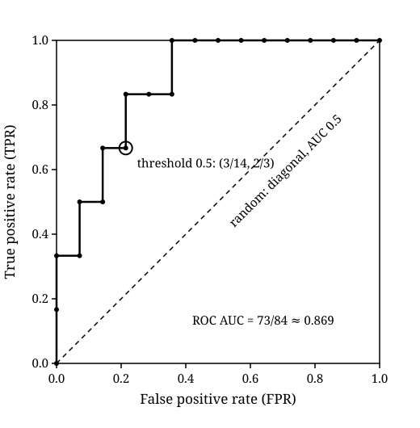
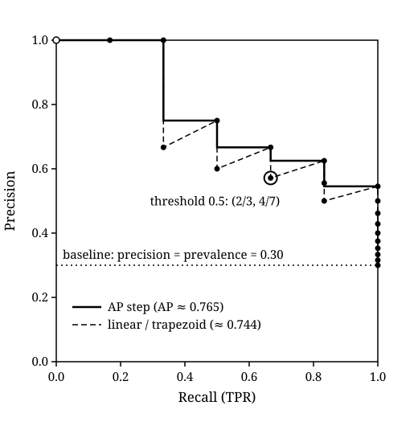

## TL;DR
Both curves come from sweeping a threshold down the sorted scores[^fawcett][^skprc]. The ROC curve plots TPR against FPR, and random guessing lies on its diagonal, where AUC is 0.5[^fawcett][^saito]. The PR curve plots precision against recall, and its random baseline sits at precision = prevalence $P/(P+N)$[^saito]. ROC AUC is the probability that a random positive scores above a random negative[^fawcett][^hm]. The area under a PR curve depends on how you join its points: linear interpolation is wrong there[^dg], and average precision $\sum_n (R_n - R_{n-1}) P_n$ is one common non-interpolated summary[^skap]. ROC ignores class skew, while PR moves with it[^fawcett][^saito]. So report PR (and name your area estimator) when positives are rare and flagged positives are what you act on, and ROC when both classes matter and the class mix may shift *(inference)*.

## Explanation
A scoring classifier outputs a number, not a label, and the [previous Finding](confusion-matrix-basic-metrics.md) needed a threshold (0.5) to turn those numbers into one confusion matrix *(inference)*. Each threshold gives a different matrix, so a single threshold metric depends on a choice that is often made later or by someone else *(inference)*. The ROC and PR curves show every threshold at once, and their areas condense the whole sweep into one number, which is what makes them the usual way to compare scoring classifiers *(inference)*. This page builds both curves and both areas on the shared toy dataset, keeping that Finding's notation: $P$ and $N$ are the numbers of actual positives and negatives, and TPR $= TP/P$, FPR $= FP/N$ *(inference)*.

### From scores to curves: the threshold sweep
- **One threshold, one matrix.** A scoring classifier used with a threshold becomes a discrete classifier, and each threshold value gives a different point in ROC space[^fawcett]. This Topic uses scikit-learn's rule: predict positive when $\text{score} \ge t$[^skroc][^skprc].
- **Sweeping by sorting.** Rather than trying every threshold, sort the instances by decreasing score[^fawcett]. Lowering the threshold past one instance moves that single instance from predicted negative to predicted positive, so $TP$ or $FP$ rises by 1 and nothing else changes *(inference)*. Starting at $t = +\infty$ (nothing predicted positive) and stopping at the lowest score (everything predicted positive) visits every distinct confusion matrix the scores can produce *(inference)*. scikit-learn's `roc_curve` adds that $t = +\infty$ point explicitly, as the classifier that always predicts negative[^skroc].
- **Steps, not curves.** An ROC "curve" from a finite test set is a step function, which approaches a true curve as the number of instances grows[^fawcett].
- **Ties.** When several instances share a score, Fawcett emits a point only after the whole tied group, which draws the diagonal of the rectangle the ties span, the expected performance over their possible orderings[^fawcett]. The toy dataset has no ties, so this does not arise below *(inference)*.

### The ROC curve: TPR against FPR
$$\text{ROC curve} = \big\{\,(\text{FPR}(t),\ \text{TPR}(t)) : t \text{ swept from } +\infty \text{ down}\,\big\}, \qquad \text{TPR} = \frac{TP}{P},\quad \text{FPR} = \frac{FP}{N}$$

- **What it plots.** The ROC curve plots the true positive rate (sensitivity) against the false positive rate, which is one minus specificity, as the threshold varies[^skguide][^fawcett].
- **Corner points.** $(0, 0)$ is the classifier that never predicts positive, $(1, 1)$ is the one that always does, and $(0, 1)$ is perfect classification[^fawcett]. A point to the northwest of another is better: higher TPR, lower FPR, or both[^fawcett].
- **The random baseline.** The diagonal $y = x$ is random guessing: a classifier that guesses positive 90% of the time expects to catch 90% of positives and 90% of negatives, the point $(0.9, 0.9)$[^fawcett]. A point below the diagonal does worse than random[^fawcett].
- **How the sweep moves.** Each positive passed moves the curve up by $1/P$, and each negative passed moves it right by $1/N$ *(inference)*. A good ranking climbs first and runs right later *(inference)*.
- **Why it ignores skew.** TPR is a ratio within the positives and FPR a ratio within the negatives, so changing the proportion of positives to negatives does not change the ROC curve[^fawcett].

### ROC AUC: computation and meaning
- **Trapezoid form.** The AUC is computed by adding the trapezoids between consecutive ROC points, then scaling to the unit square[^fawcett]. For points $(x_0, y_0), \dots, (x_K, y_K)$ in sweep order *(inference: the trapezoid rule written out)*:
  $$\text{AUC}_\text{ROC} = \sum_{k=1}^{K} (x_k - x_{k-1})\,\frac{y_k + y_{k-1}}{2}.$$
  Without ties, every step is either vertical (zero width) or horizontal (equal heights), so each trapezoid is a rectangle of width $1/N$ and the area is the mean TPR reached at each negative *(inference)*.
- **Range and baseline.** The AUC lies between 0 and 1, and random guessing gives the diagonal, area 0.5, so no realistic classifier should score below 0.5[^fawcett]. Saito and Rehmsmeier give 0.5 for random and 1.0 for perfect classifiers[^saito].
- **Probabilistic meaning.** The AUC equals the probability that the classifier ranks a randomly chosen positive instance higher than a randomly chosen negative one[^fawcett]. Hanley and McNeil showed this for the ROC area in diagnostic rating, and that it is the quantity the Wilcoxon statistic estimates[^hm].
- **Pair-counting form.** The Wilcoxon statistic scores every (positive, negative) pair as 1 if the positive scores higher, $1/2$ if tied, and 0 otherwise, and averages over all $P \cdot N$ pairs[^hm]:
  $$\text{AUC}_\text{ROC} = W = \frac{1}{P\,N} \sum_{i:\,y_i = 1}\ \sum_{j:\,y_j = 0} \Big( \mathbb{1}[s_i > s_j] + \tfrac{1}{2}\,\mathbb{1}[s_i = s_j] \Big).$$
  On their example, $W$ agrees exactly with the trapezoidal area[^hm], and Davis and Goadrich also state that the trapezoidal AUC-ROC equals the Wilcoxon-Mann-Whitney statistic[^dg]. $W$ depends only on the ranking of the scores, not their values[^hm].
- **Rank form.** Rank all $n$ scores from 1 (lowest) to $n$ (highest), and let $R_+$ be the sum of the positives' ranks *(inference)*. The positive of rank $r$ has $r - 1$ samples below it, and removing the positives among them leaves its wins over negatives; summed over the positives, this subtracts $1 + 2 + \dots + P = P(P+1)/2$ from $R_+$, so with no ties $\text{AUC}_\text{ROC} = \big(R_+ - P(P+1)/2\big)/(P\,N)$ *(inference)*.

### The PR curve: precision against recall
$$\text{PR curve} = \big\{\,(\text{recall}(t),\ \text{precision}(t))\,\big\}, \qquad \text{recall} = \frac{TP}{P},\quad \text{precision} = \frac{TP}{TP + FP}$$

- **What it plots.** The PR plot shows precision for each recall (sensitivity) value, swept over the same thresholds[^saito][^skguide]. The goal is the upper-right corner, where ROC's goal is the upper-left[^dg].
- **Same matrices, different picture.** For a fixed dataset, each ROC curve corresponds one-to-one to a PR curve containing exactly the same confusion matrices, provided recall is not 0[^dg]. At recall 0 the matrix cannot be recovered from the PR point[^dg], and precision there is $0/0$ *(inference)*. One curve dominates another in ROC space if and only if it dominates in PR space[^dg].
- **Corner points.** At the lowest threshold every sample is predicted positive, so recall is 1 and precision is the class balance $P/(P+N)$[^skprc]. scikit-learn appends a final point with precision 1 and recall 0 that has no threshold, so that the plot starts on the y axis[^skprc]. That point is a plotting convention, not a confusion matrix *(inference)*.
- **Not monotone.** Each positive passed raises recall and never lowers precision, since $(TP+1)/(TP+FP+1) \ge TP/(TP+FP)$, with equality only when precision is already 1 *(inference)*. Each negative passed lowers precision at constant recall, so the PR curve is a sawtooth, not a staircase *(inference)*.
- **The random baseline.** A random classifier's PR baseline is the horizontal line $y = P/(P+N)$, and its AUC (PRC) is $P/(P+N)$, which is 0.5 only for balanced classes[^saito]. With random predictions, AP is the fraction of positive samples[^skguide].
- **Why it depends on skew.** Precision uses values from both classes, so it changes when the class distribution changes even if the classifier does not[^fawcett]. Saito and Rehmsmeier find that, of the plots they compare, only PRC changes with the ratio of positives to negatives[^saito].

### Area under the PR curve: why linear interpolation is wrong
- **ROC can be interpolated linearly.** Any point on the straight line between two ROC points is achievable by flipping a weighted coin between the two classifiers[^dg].
- **PR cannot.** In PR space precision does not change linearly with recall, because $FP$ replaces $FN$ in precision's denominator, and linear interpolation "is a mistake that yields an overly-optimistic estimate of performance"[^dg]. Saito and Rehmsmeier repeat it: ROC analysis uses linear interpolation and PRC analysis non-linear[^saito].
- **The correct interpolation.** Between PR points $A$ and $B$, interpolate the counts: each extra true positive costs the local skew $(FP_B - FP_A)/(TP_B - TP_A)$ false positives, giving, for integers $1 \le x \le TP_B - TP_A - 1$[^dg],
  $$\left( \frac{TP_A + x}{P},\ \ \frac{TP_A + x}{TP_A + x + FP_A + \dfrac{FP_B - FP_A}{TP_B - TP_A}\,x} \right).$$
  Precision along this path is a ratio in $x$, not a line, which is why straight segments sit too high *(inference)*. With these intermediate points added, the composite trapezoidal rule approximates the area under the PR curve (AUC-PR)[^dg].
- **How large the error gets.** The error is largest when two points are far apart and the local skew is high: in Davis and Goadrich's example, the correct AUC-PR is 0.031 and linear interpolation gives 0.50[^dg].
- **AUC is not interchangeable.** An algorithm that optimizes AUC-ROC is not guaranteed to optimize AUC-PR[^dg].

### Average precision (AP)
$$\text{AP} = \sum_n (R_n - R_{n-1})\, P_n$$

- **Notation.** Here $P_n$ is the precision at the $n$-th threshold and $R_n$ the recall, not the count of positives $P$ used elsewhere in this Topic *(inference)*.
- **Definition.** scikit-learn's `average_precision_score` takes the precision $P_n$ at each threshold, weighted by the increase in recall $R_n - R_{n-1}$ from the previous threshold[^skap][^skguide].
- **Not interpolated.** This AP is not interpolated, and it differs from the trapezoidal area under the PR curve, which linearly interpolates and "can be too optimistic"[^skap]. scikit-learn switched from linear interpolation to this recall-weighted sum in version 0.19[^skap].
- **As a step function.** Only thresholds where recall increases contribute, so AP is the area under a step function that holds each new recall level at the precision reached there *(inference)*. Without ties, recall increases only when a positive is passed, so AP is the mean, over the $P$ positives, of the precision at the moment each one is reached *(inference)*.
- **Other variants exist.** The scikit-learn guide cites interpolated AP variants (Manning et al. 2008; the PASCAL VOC challenge, Everingham et al. 2010) that it does not implement, and Chen et al. 2024, which benchmarks interpolation strategies[^skguide]. So "PR-AUC" names a family of estimators, not one number *(inference)*.
- **AP vs trapezoid.** The trapezoid joins the low precision after a run of negatives to the high precision after the next positive, while AP uses only the high point *(inference)*. So on a fine-grained sweep, where each step adds one sample, the trapezoid can come out lower than AP, as in the example below *(inference)*. The over-optimism Davis and Goadrich warn about appears when points are far apart, for example a coarse set of thresholds *(inference)*.

### Class skew, briefly
- ROC curves are insensitive to changes in class distribution, because TPR and FPR each stay within one class[^fawcett]. Fawcett shows two classifiers whose ROC curves are identical at 1:1 and 1:10 class ratios while their PR curves differ substantially[^fawcett].
- The PR baseline and the area of a random classifier move with $P/(P+N)$[^saito]. So the same AP means more on a rare-positive test set than on a balanced one, and APs from test sets with different prevalence are not comparable *(inference)*.
- How imbalance should change which metric and which graph to report is its own open Question in the [Topic README](README.md) *(inference)*.

### When to use which
- **ROC AUC** summarizes how well the scores rank positives above negatives, and it does not change with the class ratio[^fawcett][^hm]. Use it when both classes matter, or when the deployment prevalence is unknown or may differ from the test set's *(inference)*.
- **PR curve and AP** answer a different question: of the instances I flag, how many are real[^saito]. ROC curves can give an overly optimistic view under a large class skew, and PR curves have been cited as the alternative for such tasks[^dg]. Use PR when positives are rare and the cost lies in reviewing flagged instances, such as retrieval, screening or fraud queues *(inference)*.
- **Both.** The two curves carry the same confusion matrices[^dg], so plotting both is cheap and shows ranking quality and precision at once *(inference)*. They can rank two classifiers differently, because optimizing one area does not optimize the other[^dg].
- **What to write in a paper.**
  - Name the PR-area estimator: step-wise AP as in scikit-learn's `average_precision_score`, a trapezoidal area over which points, or Davis-Goadrich interpolation *(inference)*. The choice changes the number, and the scikit-learn guide cites a benchmark of conflicting PR-area values across interpolation strategies[^skguide].
  - Say which endpoints the curve includes, such as scikit-learn's appended recall-0, precision-1 point, since it adds area to a trapezoidal estimate (see the example) *(inference)*.
  - Report the test-set prevalence next to any PR curve or AP *(inference)*, because it is the random baseline[^saito].
  - Draw the baseline on each plot *(inference)*: the diagonal for ROC and the horizontal prevalence line for PR[^saito].

### Example: the threshold sweep
This is the shared toy dataset from the [previous Finding](confusion-matrix-basic-metrics.md#example-the-shared-toy-dataset), unchanged: 20 samples sorted by score, $P = 6$, $N = 14$, prevalence $0.30$ *(inference)*. Each row lowers the threshold to the next score, adds that one sample to the predicted positives, and lists the resulting counts and rates *(inference: every value here was also checked with exact fractions and against scikit-learn 1.9.1's `roc_curve` and `precision_recall_curve`, not shown)*.

| step | threshold $t$ | sample added | TP | FP | TPR | FPR | precision | recall |
|---|---|---|---|---|---|---|---|---|
| 0 | $+\infty$ | none | 0 | 0 | $0$ | $0$ | undefined ($0/0$) | $0$ |
| 1 | 0.95 | s01 ($y=1$) | 1 | 0 | $1/6$ (0.167) | $0$ | $1$ | $1/6$ (0.167) |
| 2 | 0.88 | s02 ($y=1$) | 2 | 0 | $1/3$ (0.333) | $0$ | $1$ | $1/3$ (0.333) |
| 3 | 0.83 | s03 ($y=0$) | 2 | 1 | $1/3$ (0.333) | $1/14$ (0.071) | $2/3$ (0.667) | $1/3$ (0.333) |
| 4 | 0.76 | s04 ($y=1$) | 3 | 1 | $1/2$ (0.500) | $1/14$ (0.071) | $3/4$ (0.750) | $1/2$ (0.500) |
| 5 | 0.71 | s05 ($y=0$) | 3 | 2 | $1/2$ (0.500) | $1/7$ (0.143) | $3/5$ (0.600) | $1/2$ (0.500) |
| 6 | 0.64 | s06 ($y=1$) | 4 | 2 | $2/3$ (0.667) | $1/7$ (0.143) | $2/3$ (0.667) | $2/3$ (0.667) |
| 7 | 0.58 | s07 ($y=0$) | 4 | 3 | $2/3$ (0.667) | $3/14$ (0.214) | $4/7$ (0.571) | $2/3$ (0.667) |
| 8 | 0.47 | s08 ($y=1$) | 5 | 3 | $5/6$ (0.833) | $3/14$ (0.214) | $5/8$ (0.625) | $5/6$ (0.833) |
| 9 | 0.42 | s09 ($y=0$) | 5 | 4 | $5/6$ (0.833) | $2/7$ (0.286) | $5/9$ (0.556) | $5/6$ (0.833) |
| 10 | 0.37 | s10 ($y=0$) | 5 | 5 | $5/6$ (0.833) | $5/14$ (0.357) | $1/2$ (0.500) | $5/6$ (0.833) |
| 11 | 0.33 | s11 ($y=1$) | 6 | 5 | $1$ | $5/14$ (0.357) | $6/11$ (0.545) | $1$ |
| 12 | 0.29 | s12 ($y=0$) | 6 | 6 | $1$ | $3/7$ (0.429) | $1/2$ (0.500) | $1$ |
| 13 | 0.24 | s13 ($y=0$) | 6 | 7 | $1$ | $1/2$ (0.500) | $6/13$ (0.462) | $1$ |
| 14 | 0.19 | s14 ($y=0$) | 6 | 8 | $1$ | $4/7$ (0.571) | $3/7$ (0.429) | $1$ |
| 15 | 0.15 | s15 ($y=0$) | 6 | 9 | $1$ | $9/14$ (0.643) | $2/5$ (0.400) | $1$ |
| 16 | 0.12 | s16 ($y=0$) | 6 | 10 | $1$ | $5/7$ (0.714) | $3/8$ (0.375) | $1$ |
| 17 | 0.09 | s17 ($y=0$) | 6 | 11 | $1$ | $11/14$ (0.786) | $6/17$ (0.353) | $1$ |
| 18 | 0.06 | s18 ($y=0$) | 6 | 12 | $1$ | $6/7$ (0.857) | $1/3$ (0.333) | $1$ |
| 19 | 0.04 | s19 ($y=0$) | 6 | 13 | $1$ | $13/14$ (0.929) | $6/19$ (0.316) | $1$ |
| 20 | 0.02 | s20 ($y=0$) | 6 | 14 | $1$ | $1$ | $3/10$ (0.300) | $1$ |

Reading the table:
- scikit-learn's `roc_curve` with its default `drop_intermediate=True` drops collinear points, without changing the AUC or the curve's shape[^skroc], so it returns 12 of these 21 points *(inference: checked with scikit-learn 1.9.1)*.
- Step 0 is the ROC corner $(0, 0)$ and step 20 is the corner $(1, 1)$ *(inference)*. At step 20 precision is $6/20 = 0.30$, the prevalence, matching scikit-learn's first PR point (recall 1, precision = class balance) *(inference)*.
- Every threshold between 0.58 and 0.47, including 0.5, gives the same matrix as step 7: $TP = 4$, $FP = 3$ *(inference)*. That is the ROC point $(\text{FPR}, \text{TPR}) = (3/14, 2/3)$ and the PR point $(\text{recall}, \text{precision}) = (2/3, 4/7)$, the same values as the threshold-0.5 confusion matrix in the [previous Finding](confusion-matrix-basic-metrics.md) *(inference)*.
- Precision peaks at 1 for the first two steps, then saw-tooths: it drops at every negative (steps 3, 5, 7, 9, 10) and rises at every positive (steps 4, 6, 8, 11) *(inference)*.
- Recall stops rising at step 11, once s11 (the lowest-scored positive) is passed, and the last nine steps only add false positives *(inference)*.

### Example: ROC AUC by hand
The ROC curve is the 21 points $(\text{FPR}, \text{TPR})$ from the table, joined in order *(inference)*.

*Figure: the ROC curve of the toy dataset, drawn through the 21 sweep points in the table, so each positive is a step up of 1/6 and each negative a step right of 1/14 (inference). The dashed diagonal is the random-guessing baseline, whose area is 0.5[^fawcett]. The ring marks the threshold-0.5 point (3/14, 2/3) (inference). The coordinates were generated from the same exact fractions as the table (inference).*

**Trapezoid form.** Every step is vertical or horizontal, so only the 14 horizontal steps, one per negative, have area, each a rectangle of width $1/14$ at the TPR reached so far *(inference)*. Reading TPR at the six negatives that come before the last positive, then at the nine after it *(inference)*:

| negative | s03 | s05 | s07 | s09 | s10 | s12 to s20 (9 of them) |
|---|---|---|---|---|---|---|
| TPR when passed | $1/3$ | $1/2$ | $2/3$ | $5/6$ | $5/6$ | $1$ each |

$$\text{AUC}_\text{ROC} = \frac{1}{14}\left( \frac{1}{3} + \frac{1}{2} + \frac{2}{3} + \frac{5}{6} + \frac{5}{6} + 9 \cdot 1 \right) = \frac{1}{14} \cdot \frac{73}{6} = \frac{73}{84} \approx 0.869$$

*(inference: arithmetic; scikit-learn 1.9.1's `roc_auc_score` also gives 0.869048)*

**Pair-counting form.** There are $P \cdot N = 6 \cdot 14 = 84$ (positive, negative) pairs, and with no ties each pair scores 1 or 0 *(inference)*. For each negative, count the positives scored above it *(inference)*:

| negative | s03 | s05 | s07 | s09 | s10 | s12 to s20 (9 of them) |
|---|---|---|---|---|---|---|
| positives above it | 2 | 3 | 4 | 5 | 5 | 6 each |

$$W = \frac{2 + 3 + 4 + 5 + 5 + 9 \cdot 6}{84} = \frac{73}{84} \approx 0.869$$

This is the same 73/84, because each row of the second table is the first row times $P = 6$ *(inference)*. So a positive picked at random outscores a negative picked at random with probability 73/84 *(inference)*. The 11 losing pairs are s04 below s03; s06 below s03 and s05; s08 below s03, s05 and s07; and s11 below s03, s05, s07, s09 and s10, which is $1 + 2 + 3 + 5 = 11 = 84 - 73$ *(inference)*.

**Rank form.** Ranked from the bottom, the positives sit at ranks 20, 19, 17, 15, 13 and 10, so $R_+ = 94$ and $\big(94 - 6 \cdot 7/2\big)/84 = (94 - 21)/84 = 73/84$ *(inference)*.

### Example: average precision and the trapezoidal PR area by hand
The PR curve is the 20 points $(\text{recall}, \text{precision})$ of steps 1 to 20, plus scikit-learn's appended point $(0, 1)$ *(inference)*.

*Figure: the PR curve of the toy dataset, with dots at the 20 sweep points from the table and an open circle at scikit-learn's appended point (0, 1)[^skprc]. The solid step line holds each recall level at the precision reached there, which is the area AP adds up[^skap] (inference: the step reading). The dashed sawtooth joins the points with straight lines, the interpolation the trapezoidal rule uses[^skap]. The dotted line is the random baseline at precision = prevalence = 0.30[^saito]. The ring marks the threshold-0.5 point (2/3, 4/7), and the vertical run of dots at recall 1 is the nine trailing negatives (inference).*

**Average precision.** Recall increases only at the six positives, each time by $1/6$, so AP is the mean of the precisions at those steps *(inference)*:

| positive reached | s01 | s02 | s04 | s06 | s08 | s11 |
|---|---|---|---|---|---|---|
| step | 1 | 2 | 4 | 6 | 8 | 11 |
| $R_n - R_{n-1}$ | $1/6$ | $1/6$ | $1/6$ | $1/6$ | $1/6$ | $1/6$ |
| $P_n$ | $1$ | $1$ | $3/4$ | $2/3$ | $5/8$ | $6/11$ |

$$\text{AP} = \frac{1}{6}\left( 1 + 1 + \frac{3}{4} + \frac{2}{3} + \frac{5}{8} + \frac{6}{11} \right) = \frac{1211}{1584} \approx 0.7645$$

*(inference: arithmetic; scikit-learn 1.9.1's `average_precision_score` also gives 0.764520)*

**Trapezoidal PR area.** Join the points in sweep order with straight lines, starting from $(0, 1)$, and add the trapezoids *(inference)*. The vertical drops at constant recall have zero width, so six trapezoids remain, one per positive *(inference)*:

| recall interval | from point | to point | trapezoid area | AP rectangle |
|---|---|---|---|---|
| $[0, 1/6]$ | $(0, 1)$ | $(1/6, 1)$ | $\tfrac16 \cdot \tfrac{1 + 1}{2} = 1/6$ | $1/6$ |
| $[1/6, 1/3]$ | $(1/6, 1)$ | $(1/3, 1)$ | $1/6$ | $1/6$ |
| $[1/3, 1/2]$ | $(1/3, 2/3)$ | $(1/2, 3/4)$ | $\tfrac16 \cdot \tfrac{2/3 + 3/4}{2} = 17/144$ | $1/8$ |
| $[1/2, 2/3]$ | $(1/2, 3/5)$ | $(2/3, 2/3)$ | $\tfrac16 \cdot \tfrac{3/5 + 2/3}{2} = 19/180$ | $1/9$ |
| $[2/3, 5/6]$ | $(2/3, 4/7)$ | $(5/6, 5/8)$ | $\tfrac16 \cdot \tfrac{4/7 + 5/8}{2} = 67/672$ | $5/48$ |
| $[5/6, 1]$ | $(5/6, 1/2)$ | $(1, 6/11)$ | $\tfrac16 \cdot \tfrac{1/2 + 6/11}{2} = 23/264$ | $1/11$ |

$$\text{PR-AUC}_\text{trapezoid} = \frac{82469}{110880} \approx 0.7438, \qquad \text{AP} - \text{PR-AUC}_\text{trapezoid} = \frac{767}{36960} \approx 0.0208$$

*(inference: arithmetic; scikit-learn 1.9.1's `auc(recall, precision)` on the `precision_recall_curve` output also gives 0.743768)*

What the two numbers show:
- **They differ, and here the trapezoid is lower.** In the last four rows the trapezoid starts from the precision after the preceding negatives (2/3, 3/5, 4/7, 1/2) and averages it with the precision at the positive, while AP uses the precision at the positive alone *(inference)*. So the toy trapezoid comes out about 0.021 below AP, not above it *(inference)*. On any full sweep without ties, each trapezoid runs from the precision just before a positive to the precision just after it, which is never higher, so the trapezoid can never exceed AP there *(inference: from the inequality in the PR-curve section)*. scikit-learn's warning is that the trapezoid "can be too optimistic", not that it always is[^skap].
- **The endpoint matters.** The first row exists only because of the appended point $(0, 1)$, which has no threshold[^skprc]. Drop it and the trapezoid loses $1/6$, falling to $63989/110880 \approx 0.577$, while AP is unchanged because $P_1 = 1$ is a real precision at step 1 *(inference)*.
- **Davis-Goadrich interpolation adds nothing here.** Between consecutive sweep points TP rises by at most 1, so $TP_B - TP_A - 1 \le 0$ and their formula inserts no intermediate points[^dg] *(inference: applying their range of $x$ to this sweep)*. On this full sweep their composite trapezoid therefore equals the plain trapezoid, 0.744 *(inference)*.

**Where linear interpolation does overestimate.** Suppose only two operating points were known: the threshold-0.5 point $A$ ($TP_A = 4$, $FP_A = 3$, PR point $(2/3, 4/7)$) and the always-positive point $B$ ($TP_B = 6$, $FP_B = 14$, PR point $(1, 3/10)$) *(inference: a hypothetical built from the table)*. The local skew is $(14 - 3)/(6 - 4) = 11/2$ false positives per extra true positive *(inference)*. At $x = 1$, recall $5/6$, the correct interpolated precision is[^dg]

$$\frac{4 + 1}{4 + 1 + 3 + \tfrac{11}{2}} = \frac{5}{13.5} = \frac{10}{27} \approx 0.370,$$

while a straight line from $A$ to $B$ gives $\tfrac12\big(\tfrac47 + \tfrac{3}{10}\big) = 61/140 \approx 0.436$ at the same recall, too high by about 0.066 *(inference: arithmetic)*. That is the overly optimistic estimate Davis and Goadrich describe, and it grows as the points get farther apart and the local skew higher[^dg].

**A note on skew.** On a copy of this dataset with every negative repeated ten times (6 positives and 140 negatives, prevalence about 0.041), ROC AUC stays 73/84, while AP falls to about 0.441 *(inference: computed with scikit-learn 1.9.1; the shared dataset itself is not changed)*. That is Fawcett's point that ROC ignores class skew while precision-based summaries do not[^fawcett].

## Follow-ups
- How are tied scores handled in ROC and PR curves, and how do ties change ROC AUC, AP and the trapezoidal PR area?
- How are the interpolated AP variants (11-point and PASCAL VOC all-point interpolation) computed, and how do they differ from scikit-learn's non-interpolated AP?
- What is partial ROC AUC (scikit-learn's `max_fpr`), and when should it replace the full AUC?
- What are precision-recall-gain curves (Flach and Kull 2015), and do they fix the baseline and interpolation problems of PR-AUC?
- How is the standard error of an ROC AUC estimated (Hanley-McNeil, DeLong), and how are two classifiers' AUCs compared on the same test set?

[^fawcett]: [Fawcett, An introduction to ROC analysis](sources/fawcett-2006-roc-analysis.md)
[^hm]: [Hanley and McNeil, The meaning and use of the area under a ROC curve](sources/hanley-mcneil-1982-roc-area.md)
[^dg]: [Davis and Goadrich, The relationship between precision-recall and ROC curves](sources/davis-goadrich-2006-pr-roc.md)
[^saito]: [Saito and Rehmsmeier, The precision-recall plot is more informative than the ROC plot on imbalanced datasets](sources/saito-rehmsmeier-2015-prc-imbalanced.md)
[^skguide]: [scikit-learn User Guide: Metrics and scoring (1.9.1)](sources/sklearn-model-evaluation.md)
[^skroc]: [scikit-learn API: roc_curve (1.9.1)](sources/sklearn-roc-curve.md)
[^skprc]: [scikit-learn API: precision_recall_curve (1.9.1)](sources/sklearn-precision-recall-curve.md)
[^skap]: [scikit-learn API: average_precision_score (1.9.1)](sources/sklearn-average-precision-score.md)
