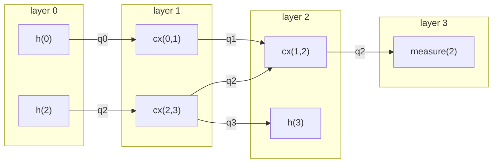

## TL;DR
In Qiskit's `DAGCircuit`, every gate becomes a node, every qubit and classical bit gets an input node and an output node, and each wire contributes one directed edge between consecutive nodes on that wire[^dag][^dagsrc]. A layer is a set of operations on disjoint qubits, and `layers()` builds layers greedily, as soon as possible, so their count equals the DAG's depth[^dag][^rxsrc]. The front layer is the first of these layers: the operations whose predecessors are all input nodes[^dag][^dagsrc]. SABRE builds its DAG and front layer from two-qubit gates only[^sabre].

## Explanation
A circuit drawing puts gates in a left-to-right order, but much of that order is arbitrary, because two gates on different qubits can run in either order or at the same time *(inference)*. A DAG keeps only the orderings that matter: two gates are ordered when they share a wire *(inference)*. Compilers work on this graph; a router, for example, repeatedly asks which gates are ready to run now, and the front layer is the answer *(inference)*. This page builds the DAG for one small circuit, then reads off its topological order, its layers and its front layer *(inference)*.

Versions: the Qiskit pages describe Qiskit 2.5, and the source read is the `stable/2.5` branch[^conv][^dagsrc]. The code below was run with qiskit 2.5.2, rustworkx 0.18.1 and Python 3.15.0 *(inference: ran with `uvx --with 'qiskit==2.5.*'`)*.

### What the graph contains
- **Three kinds of node.** A `DAGCircuit` has input nodes, output nodes and operation nodes[^dag]. An operation is a `DAGOpNode`, and wire ends are `DAGInNode` and `DAGOutNode`[^dagmod]. A `DAGOpNode` carries `op`, `name`, `qargs`, `cargs` and `params`[^opnode]. A `DAGInNode` carries the `wire` it starts[^innode].
- **One wire per qubit and per bit.** Adding a qubit, a classical bit or a classical variable creates one in node, one out node, and an edge between them[^dagsrc]. An empty wire is therefore a single edge from its in node to its out node *(inference)*.
- **Edges are labelled by wire.** The edges are directed and correspond to qubits and bits[^dag]. `edges()` yields each edge as `(source node, destination node, edge wire)`[^dag].
- **Appending a gate.** A new operation is placed between the last node on each of its wires and that wire's out node[^dagsrc]. So an edge only ever joins two consecutive nodes on the same wire, never two gates that are further apart *(inference: from the source, and checked by running Qiskit 2.5.2)*.
- **It is a multigraph.** Two gates that share two qubits are joined by two edges, one per wire[^dagsrc]. A `cx(0,1)` followed by a `cz(0,1)` gave the edges `cx → cz` on wire 0 and `cx → cz` on wire 1 *(inference: checked by running Qiskit 2.5.2)*.
- **Converting.** `circuit_to_dag(circuit)`, also available as `QuantumCircuit.to_dag()`, builds the DAG, and `dag_to_circuit(dag)`, also `DAGCircuit.to_circuit()`, turns it back into a circuit[^conv]. Both copy the operations unless `copy_operations=False`, which is safe only if the input will not be used again[^conv]. Converting the example below there and back gave a circuit equal to the original *(inference: checked by running Qiskit 2.5.2)*.

### Example: a four-qubit circuit
```python
from qiskit import QuantumCircuit
from qiskit.converters import circuit_to_dag

qc = QuantumCircuit(4, 1)
qc.h(0); qc.h(2)
qc.cx(0, 1); qc.cx(2, 3)
qc.cx(1, 2); qc.h(3)
qc.measure(2, 0)
dag = circuit_to_dag(qc)
```

The text drawer prints *(inference: ran with qiskit 2.5.2)*:

```
     ┌───┐             
q_0: ┤ H ├──■──────────
     └───┘┌─┴─┐        
q_1: ─────┤ X ├──■─────
     ┌───┐└───┘┌─┴─┐┌─┐
q_2: ┤ H ├──■──┤ X ├┤M├
     └───┘┌─┴─┐├───┤└╥┘
q_3: ─────┤ X ├┤ H ├─╫─
          └───┘└───┘ ║ 
c: 1/════════════════╩═
                     0 
```

The DAG has 17 nodes: 7 operations, plus 5 in nodes and 5 out nodes for the 4 qubits and 1 classical bit *(inference: checked by running Qiskit 2.5.2)*. `dag.edges()` lists 16 edges, regrouped here by wire as source → destination [wire] *(inference: ran with qiskit 2.5.2)*:

```
in:q0 -> h(0) [q0]             h(0) -> cx(0,1) [q0]          cx(0,1) -> out:q0 [q0]
in:q1 -> cx(0,1) [q1]          cx(0,1) -> cx(1,2) [q1]       cx(1,2) -> out:q1 [q1]
in:q2 -> h(2) [q2]             h(2) -> cx(2,3) [q2]          cx(2,3) -> cx(1,2) [q2]
cx(1,2) -> measure(2) [q2]     measure(2) -> out:q2 [q2]
in:q3 -> cx(2,3) [q3]          cx(2,3) -> h(3) [q3]          h(3) -> out:q3 [q3]
in:c0 -> measure(2) [c0]       measure(2) -> out:c0 [c0]
```

Each wire with $m$ operations on it contributes $m+1$ edges, and $3+3+5+3+2 = 16$ *(inference)*. The classical bit `c0` is a wire like any qubit: the measurement sits on both the `q2` wire and the `c0` wire *(inference: checked by running Qiskit 2.5.2)*. `cx(1,2)` has two predecessors, `cx(0,1)` through `q1` and `cx(2,3)` through `q2`, so it cannot run until both have run *(inference: checked by running Qiskit 2.5.2)*.


*Diagram: the operation nodes of the example DAG, grouped by the four layers that `layers()` returned, with each edge labelled by its wire (inference: checked by running Qiskit 2.5.2). In and out nodes are left out; each wire also has an edge from its in node to its first operation and from its last operation to its out node[^dagsrc].*

### Topological order
A topological order lists the nodes so that every edge points forward, which is possible exactly because the graph has no cycles *(inference)*. `topological_op_nodes()` yields the operation nodes in topological order, and when no `key` is given it breaks ties using each node's qargs and cargs[^dag]. For the example it gave `h(0), cx(0,1), h(2), cx(2,3), cx(1,2), h(3), measure(2)` *(inference: ran with qiskit 2.5.2)*. That order is valid but is not layer by layer, since `cx(0,1)` comes before `h(2)` *(inference: checked by running Qiskit 2.5.2)*.

### Layers
- **Definition.** A layer is a circuit whose gates act on disjoint qubits, so a layer has depth 1[^dag]. `layers()` yields one layer per unit of depth, numbered from 0 for the earliest, and the number of layers equals the circuit depth $d$[^dag].
- **The greedy rule.** Qiskit computes layers with rustworkx's `layers` function, starting from all input nodes as the first layer[^dagsrc][^rxl]. That function counts each successor's incoming edges, with multiplicity, and puts a node in the next layer as soon as all of its incoming edges come from nodes already placed[^rxsrc]. So each operation lands in the earliest layer its dependencies allow: a gate in layer $k$ has a longest chain of $k$ operations before it *(inference)*. In the example, `h(3)` lands in layer 2, right after `cx(2,3)`, even though it is drawn later than `cx(1,2)` *(inference: checked by running Qiskit 2.5.2)*.
- **What a layer looks like.** Each layer is a dict `{"graph": circuit graph, "partition": list of qubit lists}`[^dag]. In the run, each partition entry was a tuple of `Qubit` objects; the table below shows their indices *(inference: checked by running Qiskit 2.5.2)*. Its nodes are new objects, equal to the originals only under `DAGNode.semantic_eq`[^dag]. So a node from a layer cannot be used to edit the original DAG *(inference)*. `serial_layers()` instead yields one single-gate layer per gate, in the same format[^dag].
- **Classical bits.** The docs carry a TODO saying that gates using the same classical bits end up in different layers[^dag]. Two measurements from different qubits into one bit did land in two separate layers *(inference: checked by running Qiskit 2.5.2)*.

For the example, `layers()` returned four layers *(inference: ran with qiskit 2.5.2)*:

| Layer | Operations | `partition`, as qubit indices |
|---|---|---|
| 0 | `h(0)`, `h(2)` | `[[0], [2]]` |
| 1 | `cx(0,1)`, `cx(2,3)` | `[[0, 1], [2, 3]]` |
| 2 | `cx(1,2)`, `h(3)` | `[[1, 2], [3]]` |
| 3 | `measure(2)` | `[[2]]` |

### Depth and layers
`DAGCircuit.depth()` is computed as the length of the longest path through the DAG, counting edges, minus one[^dagsrc]. A path from an in node to an out node through $k$ operations has $k+1$ edges, so this is the largest number of operations on any chain *(inference)*. For the example, `dag.depth()` and `qc.depth()` are both 4, matching the four layers, and the longest chain is the `q2` wire: `h(2), cx(2,3), cx(1,2), measure(2)` *(inference: checked by running Qiskit 2.5.2)*. Measurements count toward both depths *(inference: checked by running Qiskit 2.5.2)*.

Barriers are one place where the two depths split *(inference)*. `QuantumCircuit.depth()` by default leaves out directives such as barrier[^qc], and `DAGCircuit.depth()` has no such filter[^dagsrc]. For `h(0)`, a barrier on both qubits, `cx(0,1)` and two measurements, `layers()` gave four layers, `[h], [barrier], [cx], [measure, measure]`, so `dag.depth()` was 4 but `qc.depth()` was 3 *(inference: checked by running Qiskit 2.5.2)*. With control flow present, `DAGCircuit.depth()` raises an error unless called with `recurse=True`[^dag], and the docs of `QuantumCircuit.depth()` warn that it is not well defined there[^qc].

### The front layer
`front_layer()` returns the op nodes in the first layer of the DAG[^dag]. In the source it takes the layers that start from all input nodes, skips that input layer, and keeps only the operation nodes of the next one[^dagsrc]. That next layer holds exactly the nodes whose predecessors are all input nodes, so the front layer is the set of operations with no unexecuted operation before them *(inference)*. It includes any kind of operation, so single-qubit gates, measurements and barriers all appear in it; a barrier placed first was the whole front layer *(inference: checked by running Qiskit 2.5.2)*. For the example, `dag.front_layer()` is `[h(0), h(2)]`, the same as layer 0 *(inference: ran with qiskit 2.5.2)*.

### Example: advancing the front layer
A scheduler or router treats the front layer as the gates it may execute now *(inference)*. Executing a gate can be modelled by deleting its node: `remove_op_node` removes the node and adds edges from its predecessors to its successors[^dag], and it reconnects them only along the same wire[^dagsrc]. Deleting is not running; the DAG simply forgets that the gate existed *(inference)*. Removing the gates one at a time in the topological order above gives *(inference: ran with qiskit 2.5.2)*:

| After step | Gate removed | Front layer |
|---|---|---|
| 0 | none | `h(0)`, `h(2)` |
| 1 | `h(0)` | `cx(0,1)`, `h(2)` |
| 2 | `cx(0,1)` | `h(2)` |
| 3 | `h(2)` | `cx(2,3)` |
| 4 | `cx(2,3)` | `cx(1,2)`, `h(3)` |
| 5 | `cx(1,2)` | `h(3)`, `measure(2)` |
| 6 | `h(3)` | `measure(2)` |
| 7 | `measure(2)` | empty |

After step 2, `cx(1,2)` is still not in the front layer, because it also waits on `cx(2,3)` through `q2` *(inference: checked by running Qiskit 2.5.2)*. After step 1 the front layer mixes a gate from layer 1 with a gate from layer 0, so the front layer is a moving frontier rather than a fixed layer *(inference: checked by running Qiskit 2.5.2)*. Removing the whole front layer at each round instead gives `[h(0), h(2)]`, `[cx(0,1), cx(2,3)]`, `[cx(1,2), h(3)]`, `[measure(2)]`, which is exactly the list of layers *(inference: checked by running Qiskit 2.5.2)*.

### SABRE's front layer
The SABRE paper builds its DAG from two-qubit gates only[^sabre]. It leaves out single-qubit gates because they "can always be executed locally on one qubit without bringing dependencies on other qubits"[^sabre]. In that DAG, a CNOT on $q_i, q_j$ can run only after every earlier two-qubit gate on $q_i$ or $q_j$[^sabre]. SABRE's front layer $F$ is the set of two-qubit gates with no unexecuted predecessors in this DAG, and it starts as the vertices with in-degree 0[^sabre]. SABRE then loops until $F$ is empty: it executes the gates in $F$ that the device can run, adds successors whose dependencies are resolved, and otherwise inserts a SWAP[^sabre].

So SABRE's $F$ differs from Qiskit's `front_layer()` in what counts as a node: Qiskit's includes single-qubit gates and measurements, SABRE's does not *(inference)*. As a stand-in for the paper's view, deleting every operation that does not act on two qubits from the example DAG (which also deletes the measurement) leaves a front layer of `[cx(0,1), cx(2,3)]`, against Qiskit's `[h(0), h(2)]` *(inference: checked by running Qiskit 2.5.2)*. This emulates the paper's definition; it is not taken from Qiskit's own SABRE pass, whose code this page did not read *(inference)*. How SABRE picks SWAPs from $F$ is a Question in [Qubit routing](../qubit-routing/README.md) *(inference)*.

## Follow-ups
- How does Qiskit's commutation-aware `DAGDependency` differ from `DAGCircuit`, and how do commutation-analysis passes use it?
- How does a control-flow operation (`if_else`, `for_loop`) appear in a `DAGCircuit`, and how does `depth(recurse=True)` count it?
- How does a transpiler pass read and rewrite a `DAGCircuit` (for example with `substitute_node_with_dag`)?
- How does Qiskit's `SabreSwap` build its own DAG and front layer from a `DAGCircuit`, and does it set single-qubit gates aside as the 2019 paper does?

[^dag]: [Qiskit API: DAGCircuit](sources/qiskit-dagcircuit.md)
[^dagmod]: [Qiskit API: qiskit.dagcircuit](sources/qiskit-dagcircuit-module.md)
[^opnode]: [Qiskit API: DAGOpNode](sources/qiskit-dagopnode.md)
[^innode]: [Qiskit API: DAGInNode](sources/qiskit-daginnode.md)
[^conv]: [Qiskit API: qiskit.converters](sources/qiskit-converters.md)
[^dagsrc]: [Qiskit source: dag_circuit.rs (stable/2.5)](sources/qiskit-dag-circuit-rs.md)
[^rxl]: [rustworkx API: rustworkx.layers](sources/rustworkx-layers.md)
[^rxsrc]: [rustworkx source: dag_algo.rs (0.18.1)](sources/rustworkx-dag-algo-rs.md)
[^qc]: [Qiskit API: QuantumCircuit](sources/qiskit-quantumcircuit.md)
[^sabre]: [Li, Ding and Xie, Tackling the Qubit Mapping Problem for NISQ-Era Quantum Devices](sources/li-ding-xie-2019-sabre.md)
