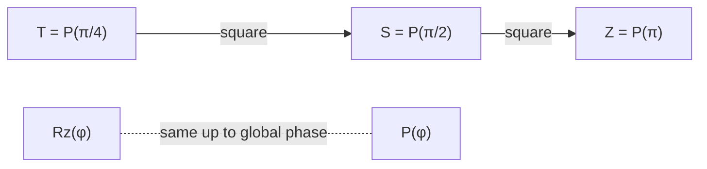
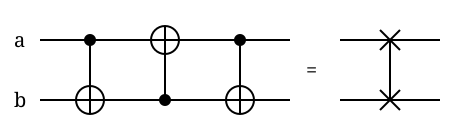

## TL;DR
$X$ flips $\lvert 0\rangle \leftrightarrow \lvert 1\rangle$, $H$ maps $\lvert 0\rangle, \lvert 1\rangle$ to $\lvert +\rangle, \lvert -\rangle$, and $S$, $T$ and $R_z$ only change the relative phase between $\lvert 0\rangle$ and $\lvert 1\rangle$, which rotates the state about the Bloch sphere's $z$ axis[^x][^h][^stdlib][^s][^t][^rz]. CNOT flips the target when the control is 1, CZ puts a $-1$ on $\lvert 11\rangle$, and SWAP exchanges two qubits at a cost of three CNOTs[^cx][^cz][^stdgates]. Qiskit labels basis states little-endian, $\lvert q_1 q_0\rangle$, so its CNOT matrix differs from the textbook one[^order][^cx].

## Explanation
Most circuits in this Topic use only these eight gates, and every SWAP a router inserts is made of them *(inference)*. The one-qubit gates are easiest to picture as rotations of a point on a sphere, and the two-qubit gates as rules for what happens to the four basis states *(inference)*. This page builds both pictures, then shows how the gates are built from each other *(inference)*.

### States and the Bloch sphere
Up to a global phase, every qubit state can be written as

$$\lvert \psi\rangle = \cos\tfrac{\theta}{2}\,\lvert 0\rangle + e^{i\varphi}\sin\tfrac{\theta}{2}\,\lvert 1\rangle,$$

which is a point on the Bloch sphere[^bloch]. On that sphere, $\lvert 0\rangle$ is the north pole and $\lvert 1\rangle$ the south pole[^bloch]. $\lvert +\rangle$ and $\lvert -\rangle$ sit on the equator on the $+x$ and $-x$ axes, and $\lvert {+i}\rangle$ and $\lvert {-i}\rangle$ sit on the $+y$ and $-y$ axes[^bloch]. A global phase does not move the point, so two gates that differ only by a global phase look the same on the sphere *(inference)*.

*Figure: the Bloch sphere, with $\lvert 0\rangle$ on $+\hat z$, $\lvert 1\rangle$ on $-\hat z$, and a state $\lvert\psi\rangle$ at polar angle $\theta$ and azimuth $\varphi$[^bloch]. Image by Glosser.ca, CC BY-SA 3.0[^wm-bloch].*

### Single-qubit gates
| Gate | Matrix | On $\lvert 0\rangle$ | On $\lvert 1\rangle$ | Bloch picture | Source |
|---|---|---|---|---|---|
| $X$ | $\begin{pmatrix}0&1\\1&0\end{pmatrix}$ | $\lvert 1\rangle$ | $\lvert 0\rangle$ | $\pi$ rotation about $x$ | [^x][^stdlib] |
| $H$ | $\tfrac{1}{\sqrt2}\begin{pmatrix}1&1\\1&-1\end{pmatrix}$ | $\lvert +\rangle$ | $\lvert -\rangle$ | $\pi$ rotation about $x+z$ | [^h][^stdlib] |
| $S$ | $\begin{pmatrix}1&0\\0&i\end{pmatrix}$ | $\lvert 0\rangle$ | $i\lvert 1\rangle$ | $\pi/2$ rotation about $z$ | [^s][^stdlib] |
| $T$ | $\begin{pmatrix}1&0\\0&e^{i\pi/4}\end{pmatrix}$ | $\lvert 0\rangle$ | $e^{i\pi/4}\lvert 1\rangle$ | $\pi/4$ rotation about $z$ | [^t][^stdlib] |
| $R_z(\varphi)$ | $\begin{pmatrix}e^{-i\varphi/2}&0\\0&e^{i\varphi/2}\end{pmatrix}$ | $e^{-i\varphi/2}\lvert 0\rangle$ | $e^{i\varphi/2}\lvert 1\rangle$ | rotation about $z$ | [^rz][^stdlib] |

$X$ is the quantum bit flip[^x]. $H$ changes the basis from $\lvert 0\rangle, \lvert 1\rangle$ to $\lvert +\rangle, \lvert -\rangle$ and back[^h]. It is its own inverse, so $H\lvert +\rangle = \lvert 0\rangle$ and $H\lvert -\rangle = \lvert 1\rangle$[^h][^qi]. Geometrically, a $\pi$ rotation about the $x+z$ axis swaps the sphere's $z$ and $x$ axes, which is why it exchanges the poles with the $\pm x$ points *(inference)*. $S$, $T$ and $R_z$ leave $\lvert 0\rangle$ and $\lvert 1\rangle$ in place up to a phase, so they move only the azimuth $\varphi$ of a state and never its height $\theta$ on the sphere *(inference)*.

*Animation: the yellow Bloch vector is turned by each gate about the red axis[^bloch]. $X$ carries $\lvert 0\rangle$ over the sphere to $\lvert 1\rangle$[^x]. $H$ carries $\lvert 0\rangle$ to $\lvert +\rangle$[^h], on a path that leaves the $xz$-plane because its axis is tilted halfway between $x$ and $z$ (inference). $S$ turns $\lvert +\rangle$ a quarter turn about $z$ to $\lvert {+i}\rangle$, and $T$ turns it an eighth of a turn[^s][^t] (inference: S and T start at $\lvert +\rangle$ because they leave $\lvert 0\rangle$ in place). $R_z(\varphi)$ turns any state by $\varphi$ about $z$[^rz]; started from a state above the equator, the vector sweeps $3\pi/2$ along a circle of fixed height, so $\theta$ stays the same (inference). Scene code: [bloch-gate-rotations.py](assets/common-gates-action/bloch-gate-rotations.py); render it with the command in its docstring.*

### Example: $H$ then $S$ on $\lvert 0\rangle$
Start at the north pole and apply $H$, then $S$ *(inference)*:

$$S H \lvert 0\rangle = S\,\tfrac{1}{\sqrt2}\big(\lvert 0\rangle + \lvert 1\rangle\big) = \tfrac{1}{\sqrt2}\big(\lvert 0\rangle + i\lvert 1\rangle\big) = \lvert {+i}\rangle.$$

The first step uses $H\lvert 0\rangle = \lvert +\rangle$[^h], and the second multiplies the $\lvert 1\rangle$ amplitude by $i$[^s]. On the sphere the state moves from the north pole down to $+x$, then a quarter turn along the equator to $+y$ *(inference: checked by matrix multiplication)*. That is the second and third segments of the animation joined end to end *(inference)*.

### Relations between the single-qubit gates
- **$HXH = Z$.** Multiplying the matrices gives this, and $HZH = X$ as well *(inference: checked by matrix multiplication)*. In words, a bit flip seen through Hadamards is a phase flip *(inference)*.
- **$S = T^2$, $S^2 = Z$.** OpenQASM 3 defines `s` as `pow(0.5) @ z` and `t` as `pow(0.5) @ s`[^stdgates]. Qiskit calls $S$ a square root of Pauli-Z and $T$ a fourth root[^s][^t].
- **Phase family.** The phase gate is $P(\theta) = \begin{pmatrix}1&0\\0&e^{i\theta}\end{pmatrix}$[^qi]. $S = P(\pi/2)$, $T = P(\pi/4)$, $Z = P(\pi)$, and the identity $I = P(0)$[^qi].
- **$R_z$ versus phase gates.** $P(\varphi) = e^{i\varphi/2} R_z(\varphi)$, so $R_z$ equals the phase gate up to a global phase[^rz]. OpenQASM 3 notes that `rz` differs from `p` by a global phase of half the rotation angle[^stdlib]. Hence $S \equiv R_z(\pi/2)$ and $T \equiv R_z(\pi/4)$ up to global phase *(inference)*. That phase is harmless on its own, but it is not harmless under control: the global-phase difference makes `cp` and `crz` different gates[^stdlib].

*Diagram: squaring walks up the phase family from $T$ to $S$ to $Z$[^stdgates][^qi], and $R_z(\varphi)$ matches $P(\varphi)$ up to a global phase[^rz].*

### Qiskit's qubit ordering (little-endian)
By default Qiskit uses little-endian ordering: qubit 0 is the least significant bit[^order]. A label is written with qubit $n-1$ leftmost and qubit 0 rightmost, so $\lvert 01\rangle$ means $q_1 = 0$ and $q_0 = 1$[^order]. Textbooks usually treat the more significant (leftmost) qubit as the control, so the same CNOT gets a different matrix in a textbook than in Qiskit[^cx]. All two-qubit states below are written in Qiskit's form, $\lvert q_1 q_0\rangle$.

### Two-qubit gates
Here `cx q0, q1` means control $q_0$ and target $q_1$[^cx]. Matrix rows and columns run over $\lvert 00\rangle, \lvert 01\rangle, \lvert 10\rangle, \lvert 11\rangle$ in Qiskit labels.

| Gate | $\lvert 00\rangle$ | $\lvert 01\rangle$ | $\lvert 10\rangle$ | $\lvert 11\rangle$ | Source |
|---|---|---|---|---|---|
| CX $q_0, q_1$ | $\lvert 00\rangle$ | $\lvert 11\rangle$ | $\lvert 10\rangle$ | $\lvert 01\rangle$ | [^cx] |
| CZ | $\lvert 00\rangle$ | $\lvert 01\rangle$ | $\lvert 10\rangle$ | $-\lvert 11\rangle$ | [^cz][^stdlib] |
| SWAP | $\lvert 00\rangle$ | $\lvert 10\rangle$ | $\lvert 01\rangle$ | $\lvert 11\rangle$ | [^swap] |

In Qiskit's ordering, their matrices are[^cx][^cz][^swap]:

$$\mathrm{CX}_{q_0 \to q_1} = \begin{pmatrix}1&0&0&0\\0&0&0&1\\0&0&1&0\\0&1&0&0\end{pmatrix},\quad \mathrm{CZ} = \begin{pmatrix}1&0&0&0\\0&1&0&0\\0&0&1&0\\0&0&0&-1\end{pmatrix},\quad \mathrm{SWAP} = \begin{pmatrix}1&0&0&0\\0&0&1&0\\0&1&0&0\\0&0&0&1\end{pmatrix}.$$

- **CNOT (CX)** flips the target when the control is $\lvert 1\rangle$; written control-first (textbook order) it maps $\lvert a, b\rangle$ to $\lvert a, a \oplus b\rangle$[^cx]. In Qiskit labels with control $q_0$, that is $\lvert q_1 q_0\rangle \to \lvert q_1 \oplus q_0,\, q_0\rangle$ *(inference)*. Its operator is $I \otimes \lvert 0\rangle\langle 0\rvert + X \otimes \lvert 1\rangle\langle 1\rvert$, with $q_0$ as the control[^cx]. The basis-state columns above follow from that matrix *(inference)*. CNOT is not symmetric, so which qubit is the control matters *(inference)*.
- **CZ** puts a $-1$ phase on $\lvert 11\rangle$ and leaves the other three basis states alone[^stdlib][^cz]. Qiskit calls it symmetric[^cz], so control and target are interchangeable and it does not care which way a coupled pair is used *(inference)*.
- **SWAP** maps $\lvert a, b\rangle$ to $\lvert b, a\rangle$ and exchanges the two qubits' states[^swap][^stdlib].

### Example: CNOT makes a Bell state
Put $q_0$ in $\lvert +\rangle$ and $q_1$ in $\lvert 0\rangle$, then apply `cx q0, q1` *(inference)*. In Qiskit labels the input is $\tfrac{1}{\sqrt2}(\lvert 00\rangle + \lvert 01\rangle)$, and the CX row of the table sends $\lvert 00\rangle \to \lvert 00\rangle$ and $\lvert 01\rangle \to \lvert 11\rangle$[^cx]:

$$\mathrm{CX}\,\tfrac{1}{\sqrt2}\big(\lvert 00\rangle + \lvert 01\rangle\big) = \tfrac{1}{\sqrt2}\big(\lvert 00\rangle + \lvert 11\rangle\big).$$

The result is the Bell state $\lvert \Phi^+\rangle$: measuring gives $00$ or $11$, never $01$ or $10$ *(inference: checked by matrix multiplication)*. This is the same H-then-CNOT circuit as the running example in [quantum-circuit-openqasm-qiskit.md](quantum-circuit-openqasm-qiskit.md) *(inference)*.

### Two-qubit relations
- **CZ from CNOT.** Qiskit's OpenQASM 2 library defines `gate cz a,b { h b; cx a,b; h b; }`, which is CZ with a Hadamard on each side of the target[^qelib]. In textbook ordering, with the target on the right, this is $\mathrm{CZ} = (I \otimes H)\,\mathrm{CNOT}\,(I \otimes H)$ *(inference)*. In Qiskit's little-endian matrices, an $H$ on target $q_1$ is written $H \otimes I$ instead *(inference: checked by matrix multiplication)*. This is the two-qubit form of $HXH = Z$ *(inference)*.
- **SWAP from three CNOTs.** Both OpenQASM 2 and OpenQASM 3 define `swap a, b { cx a, b; cx b, a; cx a, b; }`, three CNOTs with the middle one pointing the other way[^stdgates][^qelib]. This is why every SWAP a router inserts costs three two-qubit gates *(inference)*.

*Figure: `cx a, b; cx b, a; cx a, b;` equals one SWAP[^stdgates][^qelib]. A dot marks each control and $\oplus$ each target[^circ].*

## Follow-ups
- Why does the global phase between P and Rz stop being ignorable once the gate is controlled (CP vs CRZ)?
- How do Hadamards reverse a CNOT's control and target, and when does a router need that on a directed coupling map?

[^bloch]: [IBM Quantum Learning: Bloch sphere](sources/ibm-learning-bloch-sphere.md)
[^wm-bloch]: [Wikimedia Commons: Bloch Sphere.svg](sources/wikimedia-bloch-sphere-svg.md)
[^qi]: [IBM Quantum Learning: Single systems, Quantum information](sources/ibm-learning-quantum-information.md)
[^x]: [Qiskit API: XGate](sources/qiskit-xgate.md)
[^h]: [Qiskit API: HGate](sources/qiskit-hgate.md)
[^s]: [Qiskit API: SGate](sources/qiskit-sgate.md)
[^t]: [Qiskit API: TGate](sources/qiskit-tgate.md)
[^rz]: [Qiskit API: RZGate](sources/qiskit-rzgate.md)
[^cx]: [Qiskit API: CXGate](sources/qiskit-cxgate.md)
[^cz]: [Qiskit API: CZGate](sources/qiskit-czgate.md)
[^swap]: [Qiskit API: SwapGate](sources/qiskit-swapgate.md)
[^circ]: [IBM Quantum Learning: Quantum circuits](sources/ibm-learning-quantum-circuits.md)
[^order]: [Qiskit guide: Bit ordering](sources/qiskit-bit-ordering.md)
[^stdlib]: [OpenQASM 3 spec: Standard library](sources/openqasm3-standard-library.md)
[^stdgates]: [OpenQASM 3 stdgates.inc](sources/openqasm3-stdgates-inc.md)
[^qelib]: [Qiskit's OpenQASM 2 qelib1.inc](sources/qiskit-qelib1-inc.md)
