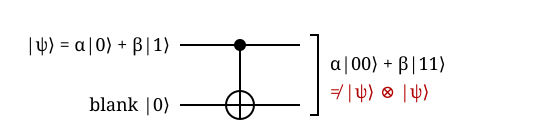
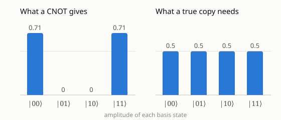

## TL;DR
No quantum operation can copy an arbitrary unknown state[^wz82]. Copying, as a unitary, would have to preserve inner products, but a copy squares them, and $x = x^2$ has only the solutions 0 and 1[^pl-teleport]. So only mutually orthogonal (or identical) states can be copied by one device[^pl-teleport].

## Explanation
Classical programs copy data all the time, and a qubit cannot be treated that way *(inference)*. This one fact shapes how quantum states are moved (teleportation, SWAP) and protected (error correction) *(inference)*. Wootters and Zurek asked whether some process, such as stimulated emission of a photon, can produce several copies of an unknown quantum state, and answered that the linearity of quantum mechanics forbids it for all quantum systems[^wz82].

### What a cloner would have to do
A cloner is a unitary $U$ that takes the state to copy, $\lvert\psi\rangle$, plus a fixed blank state $\lvert s\rangle$, and returns two copies[^pl-teleport]:

$$U\,\lvert\psi\rangle\lvert s\rangle = \lvert\psi\rangle\lvert\psi\rangle \quad\text{for every } \lvert\psi\rangle.$$

The words "for every" carry the whole theorem: a device that works only on a known, chosen set of states is allowed, as the last section shows *(inference)*.

### Proof: copying squares the overlap
Take two states $\lvert\psi\rangle$ and $\lvert\phi\rangle$ that the same $U$ copies[^pl-teleport].
- Unitaries preserve inner products, so the inner product of the two outputs equals the inner product of the two inputs, which is $\langle\psi\vert\phi\rangle$ because $\langle s\vert s\rangle = 1$[^pl-teleport].
- Directly, the inner product of the two outputs is $\langle\psi\vert\phi\rangle^2$[^pl-teleport].
- Setting $x = \langle\psi\vert\phi\rangle$ gives $x = x^2$, so $x$ is 0 or 1: the two states are either orthogonal or identical, so no single $U$ copies arbitrary states[^pl-teleport].

In words, the overlap $x$ measures how alike two states are, a unitary keeps it fixed, but two copies of each are less alike than one copy, $x^2$ instead of $x$ *(inference)*. For example, states with overlap $0.5$ would need their copies to have overlap $0.25$, which no unitary can produce *(inference)*. Only $0$ and $1$ are unchanged by squaring *(inference)*.

### Example: trying to clone with a CNOT
A CNOT maps $\lvert a, b\rangle$ to $\lvert a, a \oplus b\rangle$, so with a blank target $b = 0$ it turns $\lvert 0\rangle\lvert 0\rangle$ into $\lvert 00\rangle$ and $\lvert 1\rangle\lvert 0\rangle$ into $\lvert 11\rangle$[^cx]. It copies both basis states, so it is the natural candidate for a cloner *(inference)*.

*Figure: feeding $\lvert\psi\rangle = \alpha\lvert 0\rangle + \beta\lvert 1\rangle$ into the control and a blank $\lvert 0\rangle$ into the target[^cx]. The bracket marks that the output is one joint two-qubit state, not two separate copies (inference).*

By linearity, the CNOT acts on each term of the superposition separately *(inference)*:

$$\mathrm{CNOT}\,\big(\alpha\lvert 0\rangle + \beta\lvert 1\rangle\big)\lvert 0\rangle = \alpha\lvert 00\rangle + \beta\lvert 11\rangle.$$

A true copy would instead be the product

$$\big(\alpha\lvert 0\rangle + \beta\lvert 1\rangle\big)\otimes\big(\alpha\lvert 0\rangle + \beta\lvert 1\rangle\big) = \alpha^2\lvert 00\rangle + \alpha\beta\lvert 01\rangle + \beta\alpha\lvert 10\rangle + \beta^2\lvert 11\rangle,$$

which also contains the cross terms $\alpha\beta\lvert 01\rangle$ and $\beta\alpha\lvert 10\rangle$ *(inference)*. The two agree only if $\alpha\beta = 0$, that is, only when $\lvert\psi\rangle$ is $\lvert 0\rangle$ or $\lvert 1\rangle$ *(inference)*. The same argument works for any $U$ that copies $\lvert 0\rangle$ and $\lvert 1\rangle$, not only the CNOT *(inference)*.

*Figure: amplitudes for $\alpha = \beta = 1/\sqrt{2}$, that is, $\lvert\psi\rangle = \lvert +\rangle$ (inference: from the two equations above). The CNOT puts $1/\sqrt{2} \approx 0.71$ on $\lvert 00\rangle$ and $\lvert 11\rangle$, while a true copy $\lvert +\rangle\lvert +\rangle$ needs $0.5$ on all four basis states, including the cross terms the CNOT never produces (inference).*

For $\alpha = \beta = 1/\sqrt{2}$, the CNOT's output $\tfrac{1}{\sqrt2}(\lvert 00\rangle + \lvert 11\rangle)$ is the Bell state that H then CNOT makes: the "copy" is an entangled pair, not two independent copies *(inference)*.

### What is still allowed
The classical case is not forbidden: a device that copies only states known to be orthogonal, such as $\lvert 0\rangle$ and $\lvert 1\rangle$, exists, and a CNOT does that job, which is why classical bits can be copied *(inference)*.

For routing, this is why a router moves a qubit with SWAP (exchange the states) and never by copying the state to a neighbor *(inference)*.

The Nature letter's full text was not accessible, so the physical argument (stimulated emission, signalling) is only as detailed as its abstract[^wz82].

## Follow-ups
- How does the no-cloning theorem relate to quantum teleportation, which moves a state without copying it?
- Which approximate or probabilistic cloning machines exist, and how close to a perfect copy can they get?
- What does no-cloning imply for quantum error correction, given that a code cannot just copy a state three times?

[^wz82]: [Wootters & Zurek 1982](sources/wootters-zurek-1982.md)
[^pl-teleport]: [PennyLane: Quantum Teleportation](sources/pennylane-quantum-teleportation.md)
[^cx]: [Qiskit API: CXGate](sources/qiskit-cxgate.md)
