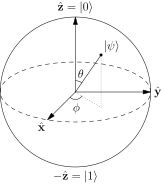

## TL;DR
A pure qubit state can be written as a unit vector $\alpha\lvert 0\rangle + \beta\lvert 1\rangle$, as a ray (that vector up to a global phase), or as a point $(\theta, \varphi)$ on the Bloch sphere; these carry the same physical information[^preskill][^bloch]. A density matrix $\rho = \tfrac12(I + \vec r\cdot\vec\sigma)$ covers those states and also mixed ones, such as noisy qubits or one half of an entangled pair, which fill the inside of the Bloch ball[^preskill][^dm-intro]. Use the vector for gate math and simulation, the Bloch sphere for single-qubit intuition, and the density matrix whenever randomness, noise or entanglement with something else is involved *(inference)*.

## Explanation
Different texts and tools describe "the state of a qubit" with different objects, and switching between them without noticing is a common source of confusion *(inference)*. They are not rival theories: each one keeps some of the information in the state vector and drops or adds something else *(inference)*. Why the starting point is a vector at all is covered in [the vector Finding](qubit-state-as-vector.md); this page lays the objects side by side *(inference)*.

### 1. State vector (ket) in $\mathbb{C}^2$
The most general normalized qubit state is $\alpha\lvert 0\rangle + \beta\lvert 1\rangle$ with complex $\alpha, \beta$ and $\lvert\alpha\rvert^2 + \lvert\beta\rvert^2 = 1$[^preskill]. With $\lvert 0\rangle$ and $\lvert 1\rangle$ as the standard basis column vectors, it is the column $\begin{pmatrix}\alpha\\\beta\end{pmatrix}$[^qi]. Gates act on it as unitary matrices, and measurement probabilities are the absolute values squared of its entries[^qi].

- **Captures:** everything about a pure state, plus an extra global phase that has no physical meaning[^preskill].
- **Loses:** it cannot describe a mixed state *(inference: shown with $I/2$ below)*.
- **Use when:** doing gate algebra by hand or writing a state-vector simulator, where matrix-times-vector is the whole computation *(inference)*.

### 2. Ray: the vector up to global phase
Preskill's first axiom says a state is a ray, the class of vectors that differ only by a nonzero complex factor[^preskill]. Picking the unit-length member leaves one free overall phase, so $\lvert\psi\rangle$ and $e^{i\gamma}\lvert\psi\rangle$ are the same state, while a relative phase between $\lvert 0\rangle$ and $\lvert 1\rangle$ is physical[^preskill]. For a qubit, the space of all such rays is the complex projective line $\mathbb{CP}^1$[^wp-bloch].

The global phase is unobservable because every measurement probability has the form $\lvert\langle a\vert\psi\rangle\rvert^2$[^preskill], and multiplying $\lvert\psi\rangle$ by $e^{i\gamma}$ multiplies $\langle a\vert\psi\rangle$ by a number of modulus 1 *(inference)*.

- **Captures:** exactly the physical content of a pure state *(inference)*.
- **Loses:** nothing physical; in practice you still compute with a representative vector *(inference)*.
- **Use when:** deciding whether two vectors are the same state, or whether two gates are equal up to global phase (as $R_z$ and the phase gate are in [the gates Finding](common-gates-action.md)) *(inference)*.

### 3. Bloch vector on the unit sphere
Every qubit state vector equals, up to a global phase, one with $\alpha \ge 0$, which gives the form[^bloch]

$$\lvert\psi\rangle = \cos\tfrac{\theta}{2}\,\lvert 0\rangle + e^{i\varphi}\sin\tfrac{\theta}{2}\,\lvert 1\rangle.$$

The two real numbers left after normalization and global phase are the polar angle $\theta$ and azimuth $\varphi$ of a direction in space[^preskill], the unit vector $\hat n = (\sin\theta\cos\varphi,\ \sin\theta\sin\varphi,\ \cos\theta)$[^preskill]. On this sphere $\lvert 0\rangle$ is the north pole, $\lvert 1\rangle$ the south pole, and $\lvert\pm\rangle$ and $\lvert{\pm i}\rangle$ sit on the $\pm x$ and $\pm y$ axes[^bloch]. A unitary acts on the qubit as a rotation of this direction[^preskill]; [the gates Finding](common-gates-action.md) animates $X$, $H$, $S$, $T$ and $R_z$ this way *(inference)*.

*Figure: the Bloch sphere, with $\lvert 0\rangle$ on $+\hat z$, $\lvert 1\rangle$ on $-\hat z$, and a pure state $\lvert\psi\rangle$ at polar angle $\theta$ and azimuth $\varphi$[^bloch]. Mixed states, covered in section 4, lie inside the sphere rather than on it[^preskill]. Image by Glosser.ca, CC BY-SA 3.0[^wm-bloch].*

- **Captures:** a pure single-qubit state with no phase ambiguity, as a point you can picture *(inference)*.
- **Loses:** it is a single-qubit picture: for larger systems the analogous shape is more complicated than a ball and much less useful to visualize[^wp-bloch]. Each half of an entangled pair has no point on the sphere at all, as section 4 shows *(inference)*.
- **Use when:** reasoning about one qubit, especially about which rotation a gate performs *(inference)*.

### 4. Density matrix and the Bloch ball
A density matrix is a matrix with unit trace that is positive semidefinite[^dm]; Preskill lists the same conditions as self-adjoint, nonnegative and trace one[^preskill]. A state vector $\lvert\psi\rangle$ has the density matrix $\rho = \lvert\psi\rangle\langle\psi\rvert$, and two vectors that differ by a global phase give the same $\rho$[^dm]. So the density matrix of a pure state is the ray of section 2 written as a matrix, with no phase left to ignore[^preskill].

Any single-qubit density matrix can be written as

$$\rho = \tfrac12\big(I + \vec r\cdot\vec\sigma\big) = \tfrac12\begin{pmatrix}1 + r_z & r_x - i r_y\\ r_x + i r_y & 1 - r_z\end{pmatrix}, \qquad \lVert\vec r\rVert \le 1,$$

with a one-to-one match between density matrices and points of the unit ball[^preskill]. The points on the boundary sphere are the pure states, and for them $\vec r$ is the Bloch vector $\hat n$ of section 3[^preskill]. Interior points are mixed states[^wp-bloch]. A pure density matrix satisfies $\rho^2 = \rho$, while a mixed one has $\operatorname{tr}\rho^2 < 1$[^preskill].

Mixed states arise in two ways *(inference)*. A preparer who picks $\rho_1$ with probability $\lambda$ and $\rho_2$ otherwise produces the mixture $\lambda\rho_1 + (1-\lambda)\rho_2$, and no measurement can tell it apart from any other preparation of the same $\rho$[^preskill]. And when a system is entangled with another, the state of the part you can see is a density operator, the partial trace $\rho_A = \operatorname{tr}_B(\lvert\psi\rangle\langle\psi\rvert)$, even when the whole is a pure state[^preskill]. IBM also lists noise among the situations density matrices are needed for[^dm-intro].

- **Captures:** every state of the qubit, pure or mixed, with no phase ambiguity[^preskill].
- **Loses:** which ensemble prepared a mixed state, since many different preparations give the same $\rho$[^preskill]. It also costs a $2^n \times 2^n$ matrix for $n$ qubits instead of a $2^n$-entry vector *(inference)*.
- **Use when:** modelling noise, random preparation, or one qubit of an entangled pair; for one qubit, the Bloch ball is the picture *(inference)*.

### 5. For contrast: three other objects
- **Classical probability vector.** A probabilistic bit is a column of nonnegative reals summing to 1[^ci]. It has no signs or phases, so it cannot tell $\lvert +\rangle$ from $\lvert -\rangle$, which give the same probabilities but different results after a Hadamard[^qi]; [the vector Finding](qubit-state-as-vector.md) works through this interference *(inference)*. It is still the right object for the classical bits a measurement produces *(inference)*.
- **$2^n$-entry state vector for $n$ qubits.** Several systems combine by tensor product[^preskill], and a joint state vector has one entry per element of the Cartesian product of the classical state sets[^ms], which is $2^n$ entries for $n$ qubits *(inference)*. A state that is not a tensor product of one-qubit states is entangled[^ms], and such a state cannot be stored as $n$ separate qubit vectors or Bloch points *(inference)*.
- **Stabilizer description.** The stabilizer formalism describes a state not by its amplitudes but by the group of operators that leave it unchanged[^ag]. A state reachable from $\lvert 0\rangle^{\otimes n}$ with CNOT, Hadamard and the phase gate $S$ (which maps $\alpha\lvert 0\rangle + \beta\lvert 1\rangle$ to $\alpha\lvert 0\rangle + i\beta\lvert 1\rangle$) is fixed uniquely by the Pauli operators that stabilize it[^ag], and the Gottesman–Knill theorem says such circuits can be simulated efficiently on a classical computer[^ag]. For a general state, writing the stabilizer group down still takes exponentially many bits[^ag]. Such circuits arise, for example, in quantum error correction[^ag]. Use it for circuits built only from CNOT, Hadamard, $S$ and measurements; adding $T$ gates takes a circuit outside this class *(inference)*.

### Comparison
The "use when" column is this page's advice, drawn from the sections above *(inference)*.

| Object | Captures | Loses or limits | Use when | Source |
|---|---|---|---|---|
| Ket $\alpha\lvert 0\rangle + \beta\lvert 1\rangle$ in $\mathbb{C}^2$ | any pure state | has an unphysical global phase; no mixed states | gate math, state-vector simulation | [^preskill][^qi] |
| Ray in $\mathbb{CP}^1$ | exactly a pure state | still computed through a representative vector | checking equality up to global phase | [^preskill][^wp-bloch] |
| Bloch angles $(\theta, \varphi)$ | a pure single-qubit state as a point | one qubit only; no entanglement | picturing one-qubit gates as rotations | [^bloch][^preskill][^wp-bloch] |
| Density matrix $\tfrac12(I + \vec r\cdot\vec\sigma)$ | pure and mixed states; subsystems | forgets the preparing ensemble; $4^n$ entries for $n$ qubits (inference) | noise, mixtures, part of an entangled system | [^preskill][^dm] |
| Probability vector | classical randomness | no phases, so no interference | measurement outcomes | [^ci][^qi] |
| Stabilizer group | states made by CNOT, H and S, compactly | only stabilizer states | CNOT, H, S circuits; error correction | [^ag] |

### Example: $\lvert +\rangle$ in every form
Take $\lvert +\rangle = \tfrac{1}{\sqrt2}(\lvert 0\rangle + \lvert 1\rangle)$[^dm].

- **Vector:** $\begin{pmatrix}1/\sqrt2\\ 1/\sqrt2\end{pmatrix}$ *(inference: from the column forms of $\lvert 0\rangle$ and $\lvert 1\rangle$[^qi])*.
- **Ray:** $\Big\{\, e^{i\gamma}\begin{pmatrix}1/\sqrt2\\ 1/\sqrt2\end{pmatrix} : \gamma \in \mathbb{R} \Big\}$; for example $-\lvert +\rangle$ is the same state *(inference: from the definition of a ray[^preskill])*.
- **Bloch angles:** $\theta = \pi/2$, $\varphi = 0$, since $\cos\tfrac{\pi}{4} = \sin\tfrac{\pi}{4} = \tfrac{1}{\sqrt2}$ *(inference)*. That is $\hat n = (1, 0, 0)$, the $+x$ axis, where IBM places $\lvert +\rangle$[^bloch].
- **Density matrix:** $\lvert +\rangle\langle +\rvert = \begin{pmatrix}\tfrac12 & \tfrac12\\ \tfrac12 & \tfrac12\end{pmatrix}$[^dm], which is $\tfrac12(I + X)$, the ball formula with $\vec r = (1, 0, 0)$ *(inference: checked by matrix arithmetic)*. It squares to itself, as a pure state must *(inference: checked by matrix multiplication)*.
- **Stabilizer:** $X$ stabilizes $\lvert 0\rangle + \lvert 1\rangle$[^ag].

### Example: the maximally mixed state $I/2$
Now take $\rho = \tfrac12 I$, the center of the Bloch ball, $\vec r = 0$[^preskill]. Preparing $\lvert 0\rangle$ or $\lvert 1\rangle$ with probability $1/2$ each gives this $\rho$, and so does preparing $\lvert +\rangle$ or $\lvert -\rangle$ with probability $1/2$ each, and no observation of the qubit can tell the two procedures apart[^preskill]. The same $\rho$ is the state of qubit $A$ in the entangled pair $\tfrac{1}{\sqrt2}(\lvert 00\rangle + \lvert 11\rangle)$: along any axis, $A$ alone gives up or down with probability $1/2$ each[^preskill].

No state vector represents it *(inference)*. A pure density matrix has one eigenvalue 1 and the other 0[^dm], but $\tfrac12 I$ has both eigenvalues equal to $1/2$, so it is not $\lvert\psi\rangle\langle\psi\rvert$ for any $\lvert\psi\rangle$ *(inference)*. Its purity is $\operatorname{tr}\rho^2 = \tfrac12 < 1$ *(inference: from $\rho^2 = \tfrac14 I$)*. Compare $\lvert +\rangle$: it too gives 0 or 1 with probability $1/2$ each in the $\lvert 0\rangle, \lvert 1\rangle$ basis, but measured along $x$ it gives $+$ with certainty, while $\tfrac12 I$ gives $1/2$ along every axis[^preskill]. The density matrix records that difference in its off-diagonal entries, $\tfrac12$ for $\lvert +\rangle$ and $0$ for $\tfrac12 I$ *(inference)*.

## Follow-ups
- How do noise channels such as dephasing and amplitude damping move a qubit's Bloch vector inside the ball?
- How does a stabilizer tableau store an $n$-qubit stabilizer state, and how do H, S and CNOT update it?
- How is a qubit's density matrix reconstructed from measurement data (state tomography)?

[^preskill]: [Preskill: Ph219 lecture notes, Chapter 2](sources/preskill-ph219-chapter-2.md)
[^qi]: [IBM Quantum Learning: Single systems, Quantum information](sources/ibm-learning-quantum-information.md)
[^ci]: [IBM Quantum Learning: Single systems, Classical information](sources/ibm-learning-classical-information.md)
[^ms]: [IBM Quantum Learning: Multiple systems, Quantum information](sources/ibm-learning-multiple-systems-quantum-information.md)
[^bloch]: [IBM Quantum Learning: Bloch sphere](sources/ibm-learning-bloch-sphere.md)
[^dm]: [IBM Quantum Learning: Density matrix basics](sources/ibm-learning-density-matrix-basics.md)
[^dm-intro]: [IBM Quantum Learning: Density matrices, Introduction](sources/ibm-learning-density-matrices-introduction.md)
[^wm-bloch]: [Wikimedia Commons: Bloch Sphere.svg](sources/wikimedia-bloch-sphere-svg.md)
[^wp-bloch]: [Wikipedia: Bloch sphere](sources/wikipedia-bloch-sphere.md)
[^ag]: [Aaronson & Gottesman 2004](sources/aaronson-gottesman-2004.md)
